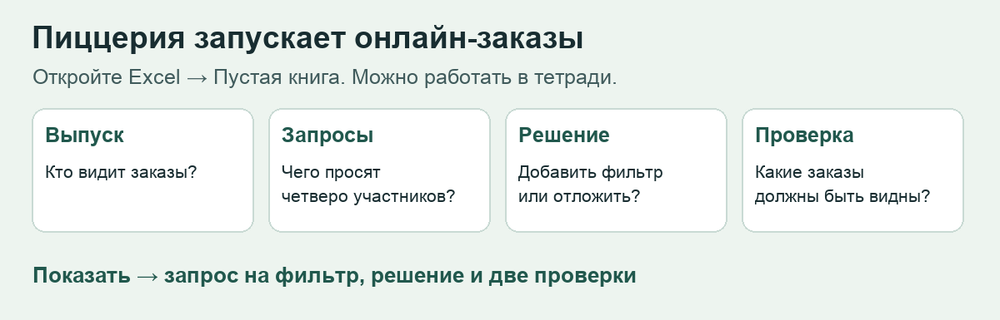

# Управление изменениями

## Лекция

**В тетради зарисуйте одну схему с пометкой «Зарисуйте».** Короткие схемы рядом с примерами помогают разобрать ситуации.

### Управление изменениями в проекте

Управление изменениями упорядочивает внесение изменений в проект. Изменение оформляется запросом, который анализируют по влиянию на сроки, бюджет и содержание, затем утверждают или отклоняют. Контроль изменений предотвращает неконтролируемое расширение содержания проекта.

**Пример.** Кафе заказало сайт с меню. Через неделю владелец попросил добавить заказ навынос. Команда выясняет, какие работы понадобятся, и передаёт запрос на согласование.

**Схема к примеру. Путь запроса на сайте кафе.**

```text
Меню на сайте → Просьба о заказе навынос → Оценка работ → Решение
```

### Исходные договорённости

Сначала проверьте, что уже согласовано: какие функции должны работать, кто ими пользуется и как их проверят. Это записано в требованиях или в плане проекта. Затем определите, с чем к вам обратились.

- **Изменение** — просят добавить новую функцию или переделать согласованную. Перед решением оцените, как это повлияет на объём работ, сроки и бюджет.
- **Возможный дефект** — уже согласованная функция работает не так, как описано в требованиях. Сначала проверьте, повторяется ли проблема.
- **Уточнение** — нужно прояснить договорённость, например кто может пользоваться функцией.

**Пример.** Автосервис согласовал запись на ремонт через сайт. Напоминание о визите — новая функция. Если уже подтверждённая запись исчезла, это возможный дефект. Вопрос о том, кто видит запись, требует уточнения.

**Схема к примеру. Изменение, дефект и уточнение в автосервисе.**

```text
Согласовали: запись на ремонт
  ├─ Добавить напоминание → изменение
  ├─ Подтверждённая запись исчезла → возможный дефект
  └─ Кто видит запись? → уточнение
```

### Запрос на изменение

В запросе указывают автора, причину, предлагаемую доработку и ожидаемый результат. Формулировка «сделать список удобнее» описывает проблему слишком широко. Формулировку «диспетчер выбирает статус и видит только заявки с этим статусом; после сброса видит исходный список» можно проверить. В запросе также указывают, для кого действует изменение и какие действия пользователей должны работать по прежним правилам.

**Пример.** Владелец интернет-магазина просит добавить фильтр по размеру обуви. В запросе фиксируют: если покупатель выбирает 38-й размер, сайт показывает только модели, доступные в этом размере.

**Схема к примеру. Запрос на фильтр по размеру обуви.**

```text
Покупатель ищет обувь → Выбирает размер 38 → Видит доступные модели
```

### Анализ последствий

Одна просьба может затронуть экран программы, права доступа, старые записи и инструкцию пользователя. Команда выясняет, какие работы нужно добавить, чем придётся пожертвовать при неизменной дате выпуска и нужны ли дополнительные расходы. Сведения, которых пока нет, записывают как вопросы к исполнителям. В решении указывают, какие условия уже подтверждены и какие ещё предстоит проверить.

**Пример.** Служба доставки хочет отправлять сообщение о прибытии курьера. Команде нужно настроить отправку, проверить доставку сообщений и уточнить стоимость услуги перед запуском.

**Схема к примеру. Оценка запроса на уведомление о курьере.**

```text
Сообщение о прибытии курьера
  ├─ Настроить отправку
  ├─ Проверить получение сообщения
  └─ Уточнить стоимость услуги
```

### Решение и обновление документов

Ответственный участник утверждает изменение, переносит его в следующий выпуск или отклоняет. В журнале решений фиксируют основание и дальнейшее действие. При согласовании уточняют требования, задачи и порядок приёмки. При переносе сохраняют запрос для следующего выпуска. При отклонении записывают причину и сообщают её автору.

**Пример.** Кинотеатр просит добавить подарочные билеты. Выпуск уже готовят к запуску, поэтому руководитель переносит работу и записывает её в план следующего выпуска.

**Схема к примеру. Перенос подарочных билетов.**

```text
Подарочные билеты → Перенос → Задача в плане следующего выпуска
```

### Разбор примера

Гостиница просит показать номер комнаты в подтверждении бронирования. Если администратор уже назначает комнату в системе, достаточно вывести номер в письме. Если комнату назначают только при заселении, придётся менять порядок работы. Руководитель согласует вывод номера для тех бронирований, где комната уже назначена.

**Схема к примеру. Условия показа номера комнаты.**

```text
Комната уже назначена?
  ├─ Да → показать номер в письме
  └─ Нет → решить, когда и кто назначает комнату
```

### Зарисуйте. Порядок работы с запросом на изменение


1. Подпишите схему «Порядок работы с запросом на изменение».
2. Нарисуйте четыре блока и соедините их стрелками слева направо: **Запрос → Анализ → Решение → Запись решения**.
3. Под блоком «Решение» подпишите три варианта: **включить в выпуск**, **перенести**, **отклонить**. Рядом укажите следующий шаг для каждого: обновить план, добавить в список будущих работ или записать причину отказа.

**Запишите в конспект** определение управления изменениями, состав запроса, порядок анализа и возможные решения.

## Рассмотрим пример ситуации. Прокат велосипедов

Посмотрим, как команда проката принимает решение перед открытием и записывает ход работы в четыре таблицы. В практической ниже вы примените этот же порядок к пиццерии.

**Ситуация.** Прокат готовит сайт к открытию в субботу. Клиент выбирает велосипед и время, бронирует поездку и видит свои брони. Администратор видит все брони и может подтвердить или отменить любую из них. После подтверждения время выдачи должно сохраняться. Состав первой версии утверждает владелец. Сайт должен заработать к открытию, денег на платные сообщения пока нет.

**Что написали участники.**

1. Администратор: «Покажите рядом с бронью, где забрать велосипед. У нас две стойки выдачи».
2. Клиент: «После подтверждения брони пропало время выдачи».
3. Маркетолог: «Давайте отправлять напоминания по СМС».
4. Владелец: «Место выдачи показываем в подтверждении брони. На странице выбора велосипеда ничего менять не нужно».

### 1. Лист «Выпуск»

В верхней таблице записываем, **что уже согласовали**. Например, «бронирует велосипед» — действие, а «видит только свои брони» — граница доступа.

| Роль | Согласованные действия | Границы доступа |
| --- | --- | --- |
| Клиент | Выбирает велосипед и время, оформляет бронь. | Видит только свои брони. |
| Администратор | Подтверждает или отменяет бронь. | Видит все брони. |

В нижней таблице указываем, **кто решает**, что ограничивает запуск и что увидит клиент после добавления доработки.

| Кто утверждает выпуск | Ограничения | Как работает личный кабинет |
| --- | --- | --- |
| Владелец проката. | Сайт нужен к открытию в субботу. Платные сообщения не согласованы. | Клиент видит свои брони. Если доработку согласуют, в подтверждении своей брони он также увидит место выдачи. |

### 2. Лист «Запросы»

Каждое сообщение занимает одну строку. Пропавшее время — **возможный дефект**, потому что время уже должно сохраняться. СМС и место выдачи добавляют новое поведение.

| Автор | Суть | Вид обращения | Кому передать | Первое действие |
| --- | --- | --- | --- | --- |
| Администратор | Показывать место выдачи. | Изменение | Владельцу | Уточнить, откуда брать название стойки. |
| Клиент | Пропало время выдачи. | Возможный дефект | Проверяющему | Создать бронь, подтвердить её и снова открыть. |
| Маркетолог | Отправлять СМС с напоминанием. | Изменение | Владельцу | Выяснить стоимость и условия подключения. |
| Владелец | Показать место только в подтверждении. | Уточнение | Команде разработки | Записать это как границу запроса. |

Под таблицей разбираем один запрос подробнее. В примере заголовок блока — **«Запрос на изменение: место выдачи велосипеда»**. В пиццерии в таком блоке будет запрос на фильтр.

| Поле | Содержание |
| --- | --- |
| Автор | Администратор проката. |
| Причина | Клиенты могут прийти не к той стойке. |
| Что добавить | Подпись «Место выдачи» в подтверждении брони. |
| Для кого действует | Для клиента, который открыл подтверждение своей брони. |
| Как проверить | Подтвердить бронь со стойкой «Парк». В подтверждении должно появиться «Парк», время выдачи должно сохраниться. |

### 3. Лист «Решение»

Сначала выясняем, что придётся изменить и кто сможет проверить результат.

| Что затронуто | Что потребуется | Кто подтвердит |
| --- | --- | --- |
| Подтверждение | Добавить подпись с названием стойки. | Администратор |
| Данные брони | Уточнить, записана ли стойка в существующих бронях. | Разработчик |
| Доступ клиента | Проверить, что клиент может открыть только своё подтверждение. | Проверяющий |
| Инструкция | Указать, где клиент увидит место выдачи. | Администратор |
| Проверка перед запуском | Сверить стойку и время для двух броней. | Проверяющий |

Затем сравниваем варианты. В графе «Риск» пишем, **что может пойти не так**, а в «Что выяснить» — **какого ответа пока не хватает**.

| Вариант | Польза | Риск | Что выяснить |
| --- | --- | --- | --- |
| Показать стойку к открытию. | Клиент знает, куда идти. | При неверной стойке клиент придёт не туда. | Есть ли у каждой брони правильное место выдачи? |
| Отложить доработку. | Команда успеет проверить, что сохраняется время. | Клиенту придётся уточнять стойку у администратора. | Может ли администратор сообщать место при подтверждении? |

| Решение | Основание | Кто утверждает | Что обновить |
| --- | --- | --- | --- |
| Отложить показ стойки. | Сначала нужно проверить, почему пропало время. До открытия администратор сообщает место при подтверждении. | Владелец проката. | План выпуска и список работ. |

**Новый факт.** Команда показала две подтверждённые брони. В обеих сохраняется время и правильно отображается стойка. Теперь можно предложить включить доработку, если владелец согласует выпуск.

| Адресат | Сообщение |
| --- | --- |
| Клиент | Проверим, сохраняется ли время после подтверждения брони, и сообщим результат. |
| Маркетолог | Для СМС уточните стоимость и условия подключения. Вернёмся к предложению после открытия. |

### 4. Лист «Проверка»

Для каждой строки представьте экран **до и после действия**. Например, до проверки у брони указана стойка «Парк», а после открытия подтверждения должно быть видно именно «Парк».

| Исходное состояние | Действие | Ожидаемый результат | Что записать при расхождении |
| --- | --- | --- | --- |
| Бронь В-01, стойка «Парк». | Открыть подтверждение В-01. | Показано «Парк». | Какое место показано вместо «Парка». |
| Бронь В-02, стойка «Вокзал». | Открыть подтверждение В-02. | Показано «Вокзал». | Если показано «Парк», указать номер брони и неверную стойку. |
| В старой брони В-03 стойка ещё не назначена. | Открыть подтверждение В-03. | Приложение показывает «Место выдачи уточняется». | Если экран пуст или показана случайная стойка, записать, что появилось. |
| В-01 принадлежит клиенту А, В-02 — клиенту Б. | Войти как клиент А и открыть список. | В списке есть В-01. В-02 не видна. | Номер чужой или пропавшей брони. |
| Для В-01 выбрано время 14:00. | Подтвердить бронь и снова открыть её. | Время 14:00 сохранилось. | Какое время показано или что поле стало пустым. |

**Предварительная договорённость для проверки.** Если стойку ещё не назначили, владелец согласовал текст «Место выдачи уточняется».

**Когда предложить отложить доработку.** Если отображается неверная стойка или клиент видит чужую бронь. Проверка сохранения времени относится к отдельной жалобе клиента.

## Практическая работа. Пиццерия запускает онлайн-заказы



**Представьте, что вы команда небольшой пиццерии.** В пятницу вечером у вас впервые можно будет заказать пиццу навынос через сайт. До запуска осталась одна смена. Кассир просит добавить фильтр, чтобы среди всех заказов видеть только те, которые ещё готовятся. В тот же день покупатель сообщает, что из заказа пропало имя для выдачи. Как кассир поймёт, кому отдать пиццу?

**Ваша задача** — предложить управляющему, **включать фильтр в пятничный запуск или отложить**, и объяснить, что нужно проверить перед открытием. Вы работаете с описанием сайта и сообщениями ниже. Сам сайт открывать или создавать не нужно.

**Что получится** — одна общая книга Excel с листами **«Выпуск», «Запросы», «Решение», «Проверка»**. Если Excel недоступен, оформите в тетради четыре подписанных раздела с таблицами по скриншотам. В конце один участник открывает книгу или тетрадь, а каждый показывает свой вклад.

### Выберите роли в команде

- **Аналитик** — делает лист «Выпуск» и показывает, что покупатель и кассир уже могут делать на сайте.
- **Координатор обращений** — делает лист «Запросы» и объясняет, чем просьба о фильтре отличается от жалобы на пропавшее имя.
- **Руководитель выпуска** — делает лист «Решение» и записывает выбор команды с причинами.
- **Тестировщик** — делает лист «Проверка» и записывает, что кассир или покупатель должны увидеть после каждого действия.
- **Представитель пиццерии** — задаёт команде вопрос от лица управляющего, например «Что будет, если после сброса кассир не увидит часть заказов?» Помогает уточнить решение и объясняет, при каком условии согласится выпустить фильтр.

Если вас меньше пяти, совмещайте роли и распределите четыре листа между собой. Начните с «Выпуска» и «Запросов». Затем вместе обсудите решение. Перед показом убедитесь, что проверки отвечают на вопрос, можно ли выпускать фильтр.

### Как пользоваться примером про прокат

1. Откройте нужный лист в [заполненном примере](#рассмотрим-пример-ситуации-прокат-велосипедов). Например, «Выпуск».
2. Найдите одноимённый лист в задании ниже. По скриншоту перенесите заголовки. По инструкции под ним заполните строки сведениями о пиццерии.
3. Сверьте смысл столбцов. В прокате «Видит только свои брони» отвечает на вопрос **«Чьи записи видны?»**. В пиццерии в этот же столбец пишут, чьи **заказы** видит покупатель.

### Как работает сайт

- **Покупатель** выбирает пиццу, оформляет заказ навынос и указывает имя для выдачи. Он видит только свои заказы.
- **Кассир** видит все заказы и меняет их статус: **«Новый» → «Готовится» → «Выдан»**. Имя для выдачи должно сохраняться и отображаться в заказе.
- **Управляющий** решает, что войдёт в пятничный запуск. Денег на дополнительные услуги нет.

### Сообщения перед запуском


1. **Кассир:** «Добавьте фильтр по статусу. Когда заказов много, трудно найти те, которые ещё готовятся».
2. **Покупатель:** «Указал имя для выдачи, но после оформления оно исчезло».
3. **Маркетолог:** «Хочу выгружать заказы вместе с телефонами покупателей для рекламной рассылки». Использование контактов для рассылки ещё предстоит согласовать.
4. **Управляющий:** «На старте фильтр нужен только кассиру. Добавляйте его, только если успеете проверить до пятницы».

**Подготовьте книгу.** В Excel выберите **«Создать → Пустая книга»**, добавьте четыре листа и подпишите их. Если работаете в тетради, подпишите четыре раздела по названиям листов.

### Этап 1. Запишите, что покупатель и кассир могут делать на сайте


Возьмите ответы из абзаца **«Как работает сайт»**. В Excel заполняйте ячейки по адресам ниже. В тетради используйте те же строки под соответствующими заголовками.

1. **Строка 2 — покупатель.** В **A2** напишите «Покупатель», в **B2** — «Выбирает пиццу и оформляет заказ навынос». В **C2** запишите, чьи заказы покупатель видит. Найдите это в условии.
2. **Строка 3 — кассир.** В **A3** напишите «Кассир». В **B3** запишите, что он делает со статусом заказа. В **C3** — чьи заказы видит.
3. **Строка 7 — решение перед запуском.** В **A7** запишите, кто решает, что войдёт в первую версию сайта. В **B7** — когда сайт должен заработать и есть ли деньги на дополнительные услуги. В **C7** — какие заказы покупатель будет видеть в своём кабинете и появится ли там фильтр. Для этой ячейки прочитайте сообщение управляющего.

Строки 1 и 6 — заголовки. Строки 4 и 5 оставьте пустыми, чтобы разделить две таблицы.

**Подсказка.** [Откройте этот лист в примере про прокат](#1-лист-выпуск). Сравните действия и доступ в верхней таблице.

### Этап 2. Разберите сообщения


- **Строки 2–5.** Возьмите четыре сообщения из раздела «Сообщения перед запуском». В каждую строку впишите одного автора и кратко передайте суть его сообщения. Определите вид каждого: предложение об изменении, сообщение о возможном дефекте или уточнение. Укажите, кому его передать и с чего начать. Для пропавшего имени запишите, какое согласованное поведение нужно проверить.
- **Строки 9–13.** В столбце **A** подпишите пять полей: «Автор», «Причина», «Что добавить», «Для кого действует», «Как проверить». Напротив каждого, в столбце **B**, запишите ответ по кейсу. В последней строке запишите, что кассир должен увидеть при выборе статуса и после сброса.

**Подсказка.** [Откройте этот лист в примере про прокат](#2-лист-запросы). Посмотрите, как отличили просьбу о новой возможности от жалобы на то, что уже должно работать.

### Этап 3. Примите решение перед запуском


1. **Строки 2–6 — что изменится при добавлении фильтра.** По одной строке на каждый пункт: экран кассира, данные заказа, доступ покупателя, инструкция кассира и проверка перед запуском. В каждой укажите работу и того, кто подтвердит результат.
2. **Строки 9–10 — варианты.** В первой строке рассмотрите запуск с фильтром, во второй — запуск без фильтра. Сравните два варианта: выпустить фильтр только для кассира или отложить. Для каждого запишите пользу, риск и вопрос, который надо выяснить до решения.
3. **Строка 14 — ваше решение.** Выберите вариант и обоснуйте его. Укажите, кто утвердит решение и какой документ обновите после утверждения, например план выпуска.
4. **Новая вводная.** Фильтр сделали, но после обновления ещё никто не проверял, сохраняется ли имя для выдачи. В свободной строке 15 допишите, меняет ли это ваш выбор и какое наблюдение поможет принять окончательное решение.
5. **Строки 17–18 — сообщения.** Напишите покупателю, что проверит команда, и маркетологу, какой вопрос о контактах нужно решить до выгрузки.

**Подсказка.** [Откройте этот лист в примере про прокат](#3-лист-решение). Посмотрите, как команда сравнила варианты и объяснила выбор.

### Этап 4. Подготовьте проверки


На экране кассира три заказа: **П-01 «Новый»**, **П-02 «Готовится»**, **П-03 «Готовится»**. П-01 и П-03 принадлежат Саше, П-02 — Жене. Заказов со статусом «Выдан» пока нет.

Заполните строки 2–6 по пяти ситуациям ниже. В столбце **A** запишите, что есть до проверки, в **B** — что делает человек, в **C** — что должно появиться на экране, в **D** — какую подробность вы запишете, если увидите другой результат.

1. Кассир выбирает «Готовится».
2. Кассир выбирает «Выдан».
3. Кассир сбрасывает фильтр после выбора «Готовится».
4. Саша открывает личный кабинет.
5. Женя оформляет новый заказ, указывает имя для выдачи и открывает заказ снова.

В **A9**, под заголовком «Когда предложить отложить фильтр», запишите, при каком результате вы отложите выпуск фильтра. Отметьте, какая проверка относится к отдельной жалобе об имени.

**Подсказка.** [Откройте этот лист в примере про прокат](#4-лист-проверка). Посмотрите, как указали конкретные номера записей до и после действия.

### Самопроверка и показ

Проверьте, что вы различили просьбу о новом фильтре и жалобу на пропавшее имя. Сверьте решение с условиями запуска. В проверках должно быть ясно, что сделать и какие заказы ожидать.

**Покажите на месте** четыре заполненных листа. Каждый показывает свою часть. В решении одним предложением ответьте, будет ли фильтр в пятницу и от чего это зависит. На листе «Проверка» покажите две строки: сброс фильтра и личный кабинет покупателя.

## Самостоятельное задание. Три просьбы перед открытием

Придумайте свой проект. Это может быть прокат самокатов, сайт музыкального фестиваля, сервис записи в барбершоп или другая знакомая ситуация. Вы готовите первую версию к открытию, а команда до открытия успеет решить только один вопрос.

1. **Опишите проект.** Запишите, кто будет им пользоваться, какие две возможности уже согласованы и что ограничивает команду перед открытием.
2. **Напишите три сообщения от участников.** Один просит новую возможность, другой сообщает, что уже согласованная возможность работает неправильно, третий уточняет, кому доступна одна из функций. Напишите каждое сообщение словами персонажа.
3. **Подготовьте ответ команды.** Под каждым сообщением укажите, кто возьмёт его в работу и что сделает первым. Выберите одно обращение, которым команда займётся до открытия. Объясните, что произойдёт с остальными и почему ваш выбор важен для пользователей.
4. **Добавьте поворот.** Придумайте новый факт, который мог бы изменить ваше решение. Запишите, что именно вы изменили бы и почему.

**Что показать.** Один отдельный лист Excel или одну страницу тетради с описанием проекта, тремя сообщениями и решением до и после нового факта.
