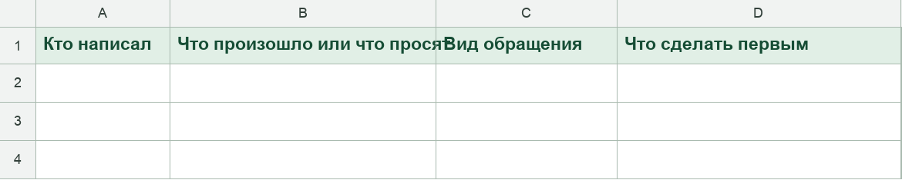

# Управление изменениями

**Главный вопрос занятия.** Если перед запуском просят добавить новую функцию, как решить, делать её сейчас или отложить?

1. **Разберите порядок действий** в лекции и зарисуйте отмеченную схему.
2. **Проследите, как команда проката применяет этот порядок.** Посмотрите, как команда заполнила одну таблицу и записала решение.
3. **Примите своё решение для пиццерии.** После работы в команде придумайте собственную ситуацию и разберите её самостоятельно.

## Лекция

**В тетради зарисуйте одну схему с пометкой «Зарисуйте».** Короткие схемы показывают отдельные шаги на одном примере — сайте проката велосипедов.

### Управление изменениями в проекте

Управление изменениями упорядочивает внесение изменений в проект. Изменение оформляется запросом, который анализируют по влиянию на сроки, бюджет и содержание, затем утверждают или отклоняют. Контроль изменений предотвращает неконтролируемое расширение содержания проекта.

**Пример.** Прокат готовит сайт, на котором можно забронировать велосипед. Перед открытием администратор просит показать в подтверждении, у какой стойки забрать велосипед. Команда оформляет запрос и выясняет, успеет ли добавить эту подсказку.

**Схема к примеру. Путь запроса на сайте проката.**

```text
Сайт с бронированием → Просьба показать стойку → Оценка работ → Решение
```

### Исходные договорённости

Сначала проверьте, что уже согласовано: какие функции должны работать, кто ими пользуется и как их проверят. Это записано в требованиях или в плане проекта. Затем определите, с чем к вам обратились.

- **Изменение** — просят добавить новую функцию или переделать согласованную. Перед решением оцените, как это повлияет на объём работ, сроки и бюджет.
- **Возможный дефект** — уже согласованная функция работает не так, как описано в требованиях. Сначала проверьте, повторяется ли проблема.
- **Уточнение** — нужно прояснить договорённость, например кто может пользоваться функцией.

**Пример.** Прокат уже договорился, что время выдачи должно сохраняться после подтверждения брони. Если время пропало, это возможный дефект. Просьба добавить название стойки — изменение. Вопрос «Где именно показывать стойку?» — уточнение.

**Схема к примеру. Три вида обращений в прокате.**

```text
Согласовали: бронирование с сохранением времени выдачи
  ├─ Добавить название стойки → изменение
  ├─ Пропало время выдачи → возможный дефект
  └─ Где показывать стойку? → уточнение
```

### Запрос на изменение

В запросе указывают автора, причину, предлагаемую доработку и ожидаемый результат. Формулировку «помогите клиенту найти велосипед» нужно уточнить. Например: «В подтверждении своей брони клиент видит название стойки выдачи». В запросе также указывают, для кого действует изменение и какие действия пользователей должны работать по прежним правилам.

**Пример.** Администратор просит показать стойку, чтобы клиент пришёл в нужное место. В запросе записывают, что доработка действует только в подтверждении брони.

**Схема к примеру. Что записать в запросе на показ стойки.**

```text
Клиенту нужно найти стойку → Добавить её название → Показать в подтверждении
```

### Анализ последствий

Одна просьба может затронуть экран программы, права доступа, старые записи и инструкцию пользователя. Команда выясняет, какие работы нужно добавить, чем придётся пожертвовать при неизменной дате выпуска и нужны ли дополнительные расходы. Сведения, которых пока нет, записывают как вопросы к исполнителям. В решении указывают, какие условия уже подтверждены и какие ещё предстоит проверить.

**Пример.** Команда проката выясняет, откуда сайт возьмёт название стойки и что показать в старой брони, если стойку ещё не назначили. Также нужно проверить, что после доработки время выдачи остаётся в подтверждении.

**Схема к примеру. Оценка запроса на показ стойки.**

```text
Показ стойки
  ├─ Уточнить, где хранится название
  ├─ Определить, что показать без назначенной стойки
  └─ Проверить, что время выдачи сохраняется
```

### Решение и обновление документов

Ответственный участник утверждает изменение, переносит его в следующий выпуск или отклоняет. В журнале решений фиксируют основание и дальнейшее действие. При согласовании уточняют требования, задачи и порядок приёмки. При переносе сохраняют запрос для следующего выпуска. При отклонении записывают причину и сообщают её автору.

**Пример.** Если команда не успевает проверить стойку и время выдачи к открытию, владелец может отложить показ стойки. Тогда администратор пока сообщает место выдачи при подтверждении, а команда записывает доработку в план следующего выпуска.

**Схема к примеру. Пример решения перед открытием.**

```text
Проверка не готова → Отложить показ стойки → Записать в план следующего выпуска
```

### Проверка перед запуском

После решения команда записывает, что именно нужно проверить. Для каждой проверки укажите, какие данные есть в начале, что сделать и что должно появиться на экране. Если результат отличается, запишите, что увидели. По этим записям можно понять, выполнены ли условия для запуска.

**Схема к примеру. Проверка подтверждения брони.**

```text
В брони указана стойка «Парк» → Открыть подтверждение → Видно «Парк»
```

### Зарисуйте. Порядок работы с запросом на изменение


1. Подпишите схему «Порядок работы с запросом на изменение».
2. Нарисуйте четыре блока и соедините их стрелками слева направо: **Запрос → Анализ → Решение → Запись решения**.
3. Под блоком «Решение» подпишите три варианта: **включить в выпуск**, **перенести**, **отклонить**. Рядом укажите следующий шаг для каждого: обновить план, добавить в список будущих работ или записать причину отказа.

**Запишите в конспект** определение управления изменениями, состав запроса, порядок анализа и возможные решения.

## Рассмотрим пример ситуации. Прокат велосипедов

Прокат уже обещал, что клиент увидит время выдачи велосипеда в подтверждении брони. Перед открытием администратор попросил показывать там и **название стойки**. Пока доработку проверяли, клиент сообщил, что из его подтверждения исчезло время выдачи. Владелец уточнил, что стойку нужно показывать только в подтверждении.

| Кто написал | Что произошло или что просят | Вид обращения | Что сделать первым |
| --- | --- | --- | --- |
| Администратор | Просит показать название стойки. | Изменение | Узнать, откуда сайт возьмёт название стойки. |
| Клиент | В подтверждении пропало время выдачи. | Возможный дефект | Подтвердить бронь и проверить, осталось ли время. |
| Владелец | Показать стойку только в подтверждении. | Уточнение | Записать это условие в запрос на изменение. |

**Решение.** Пока отложим показ стойки. Вернёмся к нему, когда проверим, что время выдачи сохраняется.

**Проверка перед открытием.** Подтвердим бронь на 14:00 у стойки «Парк» и откроем её снова. Должны быть видны и время 14:00, и стойка «Парк».

## Практическая работа. Пиццерия запускает онлайн-заказы

**Представьте, что вы команда пиццерии.** В пятницу вечером открываются онлайн-заказы. Кассир видит все заказы, а покупатель в своём кабинете — только свои. Сайт должен сохранять имя для выдачи, чтобы кассир знал, кому отдать пиццу.

Перед запуском пришли три сообщения:

1. **Кассир:** «Хочу выбрать “Готовится” и увидеть только заказы с этим статусом».
2. **Покупатель:** «После оформления заказа пропало имя для выдачи».
3. **Управляющий:** «Если добавите фильтр, он должен быть только у кассира».

### 1. Заполните одну таблицу

Откройте **Excel → Создать → Пустая книга**. Назовите лист **«Пиццерия»**. Если Excel нет, начертите и подпишите ту же таблицу в тетради. Можно работать вместе: распределите три сообщения, затем примите решение всей командой.



На каждое сообщение заполните одну строку. В первые два столбца перенесите автора и суть. В третьем выберите **«изменение»**, **«возможный дефект»** или **«уточнение»**. В последнем напишите, с чего начнёте: что выясните или проверите. Сверьтесь с заполненным примером про прокат.

### 2. Решите, добавлять ли фильтр

Под таблицей закончите две фразы:

- **Мы предлагаем добавить фильтр к пятнице / отложить фильтр, потому что…** Выберите один вариант и объясните его одной фразой.
- **Перед запуском мы проверим…** Укажите, что нужно подтвердить по жалобе на пропавшее имя.

### 3. Напишите две проверки для кассира

Представьте, что кассир видит три заказа: **П-01 — «Новый»**, **П-02 — «Готовится»**, **П-03 — «Готовится»**. Сайт запускать не требуется. Допишите на этом же листе:

1. Выбрать «Готовится». На экране должны остаться…
2. Нажать «Сбросить». На экране должны появиться…

**Что показать преподавателю.** Одну страницу: три строки с обращениями, ваше решение и две проверки. Если работаете командой, достаточно открыть одну общую работу.

## Самостоятельное задание. Три просьбы перед открытием

В пиццерии исходные договорённости и сообщения были заданы. Теперь задайте их сами и решите, каким обращением заняться первым. Придумайте свой проект. Это может быть прокат самокатов, сайт музыкального фестиваля, сервис записи в барбершоп или другая знакомая ситуация. Вы готовите первую версию к открытию, а команда до открытия успеет решить только один вопрос.

1. **Опишите проект.** Запишите, кто будет им пользоваться, какие две возможности уже согласованы и что ограничивает команду перед открытием.
2. **Напишите три сообщения от участников.** Один просит новую возможность, другой сообщает, что уже согласованная возможность работает неправильно, третий уточняет, кому доступна одна из функций. Напишите каждое сообщение словами персонажа.
3. **Подготовьте ответ команды.** Под каждым сообщением укажите, кто возьмёт его в работу и что сделает первым. Выберите одно обращение, которым команда займётся до открытия. Объясните, что произойдёт с остальными и почему ваш выбор важен для пользователей.
4. **Добавьте поворот.** Придумайте новый факт, который мог бы изменить ваше решение. Запишите, что именно вы изменили бы и почему.

**Что показать.** Один отдельный лист Excel или одну страницу тетради с описанием проекта, тремя сообщениями и решением до и после нового факта. Добавьте одну проверку, по которой будет понятно, что выбранная работа выполнена.
