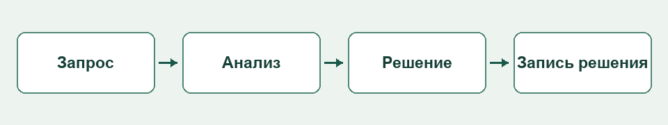

# Управление изменениями

**Главный вопрос занятия.** Как понять, чем заняться до запуска, когда одновременно приходят просьбы, жалобы и вопросы?

1. **Разберите порядок действий** в лекции и зарисуйте отмеченную схему.
2. **Проследите, как команда сайта подкаста применяет этот порядок.** Посмотрите на заполненную таблицу и решение.
3. **Соберите обращения в одну таблицу.** Возьмите готовый кейс про пиццерию или выберите свою тему.

## Лекция

**В тетради зарисуйте одну схему с пометкой «Зарисуйте».** Короткие схемы показывают отдельные шаги на одном примере — сайте проката велосипедов.

### Управление изменениями в проекте

Управление изменениями упорядочивает внесение изменений в проект. Изменение оформляется запросом, который анализируют по влиянию на сроки, бюджет и содержание, затем утверждают или отклоняют. Контроль изменений предотвращает неконтролируемое расширение содержания проекта.

**Пример.** Прокат готовит сайт, на котором можно забронировать велосипед. Перед открытием администратор просит показать в подтверждении, у какой стойки забрать велосипед. Команда оформляет запрос и выясняет, успеет ли добавить эту подсказку.

**Схема к примеру. Путь запроса на сайте проката.**

```text
Сайт с бронированием → Просьба показать стойку → Оценка работ → Решение
```

### Исходные договорённости

Сначала проверьте, что уже согласовано: какие функции должны работать, кто ими пользуется и как их проверят. Это записано в требованиях или в плане проекта. Затем определите, с чем к вам обратились.

- **Изменение** — просят добавить новую функцию или переделать согласованную. Перед решением оцените, как это повлияет на объём работ, сроки и бюджет.
- **Возможный дефект** — уже согласованная функция работает не так, как описано в требованиях. Сначала проверьте, повторяется ли проблема.
- **Уточнение** — нужно прояснить договорённость, например кто может пользоваться функцией.

**Пример.** Прокат уже договорился, что время выдачи должно сохраняться после подтверждения брони. Если время пропало, это возможный дефект. Просьба добавить название стойки — изменение. Вопрос «Где именно показывать стойку?» — уточнение.

**Схема к примеру. Три вида обращений в прокате.**

```text
Согласовали: бронирование с сохранением времени выдачи
  ├─ Добавить название стойки → изменение
  ├─ Пропало время выдачи → возможный дефект
  └─ Где показывать стойку? → уточнение
```

### Запрос на изменение

В запросе указывают автора, причину, предлагаемую доработку и ожидаемый результат. Формулировку «помогите клиенту найти велосипед» нужно уточнить. Например: «В подтверждении своей брони клиент видит название стойки выдачи». В запросе также указывают, для кого действует изменение и какие действия пользователей должны работать по прежним правилам.

**Пример.** Администратор просит показать стойку, чтобы клиент пришёл в нужное место. В запросе записывают, что доработка действует только в подтверждении брони.

**Схема к примеру. Что записать в запросе на показ стойки.**

```text
Клиенту нужно найти стойку → Добавить её название → Показать в подтверждении
```

### Анализ последствий

Одна просьба может затронуть экран программы, права доступа, старые записи и инструкцию пользователя. Команда выясняет, какие работы нужно добавить, чем придётся пожертвовать при неизменной дате выпуска и нужны ли дополнительные расходы. Сведения, которых пока нет, записывают как вопросы к исполнителям. В решении указывают, какие условия уже подтверждены и какие ещё предстоит проверить.

**Пример.** Команда проката выясняет, откуда сайт возьмёт название стойки и что показать в старой брони, если стойку ещё не назначили. Также нужно проверить, что после доработки время выдачи остаётся в подтверждении.

**Схема к примеру. Оценка запроса на показ стойки.**

```text
Показ стойки
  ├─ Уточнить, где хранится название
  ├─ Определить, что показать без назначенной стойки
  └─ Проверить, что время выдачи сохраняется
```

### Решение и обновление документов

Ответственный участник утверждает изменение, переносит его в следующий выпуск или отклоняет. В журнале решений фиксируют основание и дальнейшее действие. При согласовании уточняют требования, задачи и порядок приёмки. При переносе сохраняют запрос для следующего выпуска. При отклонении записывают причину и сообщают её автору.

**Пример.** Если команда не успевает проверить стойку и время выдачи к открытию, владелец может отложить показ стойки. Тогда администратор пока сообщает место выдачи при подтверждении, а команда записывает доработку в план следующего выпуска.

**Схема к примеру. Пример решения перед открытием.**

```text
Проверка не готова → Отложить показ стойки → Записать в план следующего выпуска
```

### Проверка перед запуском

После решения команда записывает, что именно нужно проверить. Для каждой проверки укажите, какие данные есть в начале, что сделать и что должно появиться на экране. Если результат отличается, запишите, что увидели. По этим записям можно понять, выполнены ли условия для запуска.

**Схема к примеру. Проверка подтверждения брони.**

```text
В брони указана стойка «Парк» → Открыть подтверждение → Видно «Парк»
```

### Зарисуйте. Порядок работы с запросом на изменение



1. Подпишите схему «Порядок работы с запросом на изменение».
2. Нарисуйте четыре блока и соедините их стрелками слева направо: **Запрос → Анализ → Решение → Запись решения**.
3. Под блоком «Решение» подпишите три варианта: **включить в выпуск**, **перенести**, **отклонить**. Рядом укажите следующий шаг для каждого: обновить план, добавить в список будущих работ или записать причину отказа.

**Запишите в конспект** определение управления изменениями, состав запроса, порядок анализа и возможные решения.

## Рассмотрим пример ситуации. Подкаст выходит в эфир

На лекции мы разобрали, как отличить новую просьбу от проблемы с обещанной функцией. Теперь посмотрим, как это записать в таблице. Команда запускает сайт подкаста. Она уже обещала, что слушатель сможет открыть выпуск, прослушать его и скачать расшифровку. Редактор может скрыть черновик от слушателей. До запуска остался день. Сначала прочитайте сообщения в таблице, затем посмотрите, как команда выбрала первое действие. В практической вы повторите эти шаги со своей темой или пиццерией.

**Как выбрать ответ для столбца «Что это?»**

- **Хотят добавить** — просят функцию, которой ещё не обещали.
- **Что-то не работает** — обещанная функция ведёт себя не так, как должна.
- **Нужно уточнить** — из договорённостей пока непонятно, как должно быть.

| Проект | Кто придумал строку | Кто написал в истории | Что написал | Что это? | Что сделать первым |
| --- | --- | --- | --- | --- | --- |
| Сайт подкаста | Лера | Слушатель | «Нажимаю “Скачать расшифровку”, но получаю пустой файл». | Что-то не работает | Скачать файл с того же выпуска и проверить его содержимое. |
| Сайт подкаста | Лера | Ведущий | «Добавьте возможность поделиться выпуском в мессенджере». | Хотят добавить | Уточнить, нужна ли ссылка на весь выпуск или на выбранное место в записи. |
| Сайт подкаста | Лера | Редактор | «Черновик скрыт. А по прямой ссылке слушатель его откроет?» | Нужно уточнить | Согласовать, каким должен быть доступ по прямой ссылке. |
| Сайт подкаста | Лера | Слушатель | «На телефоне звук останавливается через несколько секунд». | Что-то не работает | Уточнить выпуск и браузер, затем повторить прослушивание. |
| Сайт подкаста | Лера | Продюсер | «Хочу получать уведомление о каждом новом комментарии». | Хотят добавить | Уточнить, нужны ли вообще комментарии в первой версии. |
| Сайт подкаста | Лера | Автор расшифровки | «Можно заменить файл после публикации или нужно просить редактора?» | Нужно уточнить | Договориться, кто имеет право менять опубликованный файл. |

**Решение перед запуском.** Команда сначала разбирается с пустой расшифровкой и остановкой звука, потому что это уже обещанные возможности. Кнопку «Поделиться» можно запланировать после запуска. Проверка расшифровки простая: слушатель открывает выпуск, скачивает файл и видит текст именно этого выпуска.

## Практическая работа. Команда перед запуском

**Представьте, что вы готовите сервис к открытию.** Пользователи уже присылают сообщения: кто-то просит новую функцию, у кого-то что-то сломалось, а кому-то нужно уточнение. Как в примере про подкаст, сначала разберите сообщения, затем решите, чем заняться до запуска.


**Что получится.** Одна общая таблица и три коротких решения под ней. В Excel откройте пустую книгу и назовите лист **«Обращения»**. Если Excel нет, начертите такую же таблицу в одной тетради. Один человек начинает заполнять таблицу, остальные предлагают строки и проверяют друг друга. Можете меняться.

### 1. Возьмите готовую тему

**Пиццерия.** В пятницу открываются онлайн-заказы. Покупатель видит свои заказы, кассир — все. Сайт должен сохранять имя для выдачи. Вот три сообщения, с которых можно начать:

- **Кассир:** «Хочу выбрать статус “Готовится” и увидеть только такие заказы».
- **Покупатель:** «После оформления заказа пропало имя для выдачи».
- **Управляющий:** «Если добавите фильтр, он должен быть только у кассира».

Можно всей командой работать с пиццерией. Если кто-то хочет свой сервис, пусть напишет его название и одну фразу о том, **что сервис уже должен уметь**. Например: «Прокат самокатов. Клиент должен видеть, где оставить самокат после поездки». Дальше он добавляет строки в ту же общую таблицу под названием своего сервиса.

### 2. Заполните первую строку

Перенесите заголовки из заполненного примера про подкаст. Если неясно, с чего начать, вот готовая строка про кассира:

| Проект | Кто придумал строку | Кто написал в истории | Что написал | Что это? | Что сделать первым |
| --- | --- | --- | --- | --- | --- |
| Пиццерия | Дано в задании | Кассир | «Хочу видеть только заказы со статусом “Готовится”». | Хотят добавить | Уточнить, на каком экране кассиру нужен фильтр. |

Второй столбец — про **вашу команду**. Третий — про **персонажа в истории**. Если Даша сама придумала сообщение от покупателя, пишем «Даша» во втором и «Покупатель» в третьем. Для готовых сообщений пишем «Дано в задании».

В столбце **«Что это?»** выберите одну из трёх фраз:

- **Хотят добавить.** Этого ещё не обещали. Например, кассир просит новый фильтр.
- **Что-то не работает.** Это уже должно работать. Например, сайт должен сохранить имя, но оно пропало.
- **Нужно уточнить.** Нужно выяснить или записать условие. Например, управляющий говорит, кому должен быть доступен фильтр.

В последнем столбце пишите **одно действие, с которого начнёте**. Например: «Оформить пробный заказ с именем “Саша”, открыть его снова и проверить, видно ли имя». Ваша задача — описать проверку. Запускать сайт для этого не нужно.

### 3. Добавьте свои сообщения

Разберите оставшиеся готовые сообщения, если работаете с пиццерией. Затем каждый участник придумывает как можно больше **разных** сообщений и добавляет свои строки. Если темы разные, проверяйте «Что это?» по договорённостям именно того сервиса, который записан в строке.

**Если идеи закончились**, смените персонажа. Представьте, что пишет курьер, новый покупатель или сотрудник на первой смене. Спросите себя: «Что он хочет сделать? Что могло не сработать? Какое правило ему непонятно?» Затем обменяйтесь идеями с соседом. Если два сообщения про одно и то же, оставьте более конкретное.

**ИИ использовать можно.** Попросите его предложить идеи, объяснить непонятную строку или проверить ваш вариант. Выберите идею, которая подходит вашему сервису, и сформулируйте сообщение своими словами.

> Мой сервис — [название]. Он уже должен уметь [функции]. Предложи сообщения от разных людей перед запуском: просьбы добавить функцию, жалобы на то, что уже должно работать, и вопросы про правила. Если я пришлю свою строку, помоги понять, какое из трёх названий подходит и с чего начать. Объясни простыми словами.

### 4. Примите решение всей командой

Когда таблица собрана, выберите из неё обращения для трёх решений и допишите под таблицей три строки. Можно брать обращения из разных проектов. Укажите проект в каждой строке.

1. **До запуска займёмся…** Назовите обращение и объясните, кому оно мешает. Напишите, что проверите. Пример из подкаста: проверим пустую расшифровку, иначе слушатели не смогут прочитать выпуск.
2. **На потом оставим…** Назовите новую возможность и объясните, почему сервис сможет работать без неё. Пример: отложим кнопку «Поделиться», потому что выпуски уже можно слушать на сайте.
3. **Спросим…** Назовите человека и сформулируйте конкретный вопрос. Пример: «Редактор, слушатель должен видеть черновик по прямой ссылке?»

**Что показать преподавателю.** Откройте общую таблицу в Excel или покажите её в тетради. Каждый участник показывает одну придуманную строку. Затем команда показывает три решения под таблицей и объясняет, с чего начнёт перед запуском.
