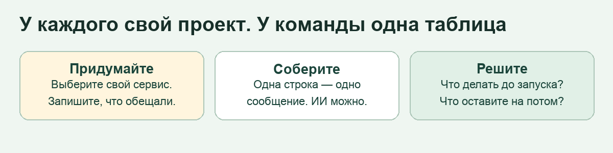

# Управление изменениями

**Главный вопрос занятия.** Если перед запуском просят добавить новую функцию, как решить, делать её сейчас или отложить?

1. **Разберите порядок действий** в лекции и зарисуйте отмеченную схему.
2. **Проследите, как команда сайта подкаста применяет этот порядок.** Посмотрите на заполненную таблицу и решение.
3. **Выберите свой проект.** В команде соберите обращения по разным проектам и решите, чем заняться перед запуском.

## Лекция

**В тетради зарисуйте одну схему с пометкой «Зарисуйте».** Короткие схемы показывают отдельные шаги на одном примере — сайте проката велосипедов.

### Управление изменениями в проекте

Управление изменениями упорядочивает внесение изменений в проект. Изменение оформляется запросом, который анализируют по влиянию на сроки, бюджет и содержание, затем утверждают или отклоняют. Контроль изменений предотвращает неконтролируемое расширение содержания проекта.

**Пример.** Прокат готовит сайт, на котором можно забронировать велосипед. Перед открытием администратор просит показать в подтверждении, у какой стойки забрать велосипед. Команда оформляет запрос и выясняет, успеет ли добавить эту подсказку.

**Схема к примеру. Путь запроса на сайте проката.**

```text
Сайт с бронированием → Просьба показать стойку → Оценка работ → Решение
```

### Исходные договорённости

Сначала проверьте, что уже согласовано: какие функции должны работать, кто ими пользуется и как их проверят. Это записано в требованиях или в плане проекта. Затем определите, с чем к вам обратились.

- **Изменение** — просят добавить новую функцию или переделать согласованную. Перед решением оцените, как это повлияет на объём работ, сроки и бюджет.
- **Возможный дефект** — уже согласованная функция работает не так, как описано в требованиях. Сначала проверьте, повторяется ли проблема.
- **Уточнение** — нужно прояснить договорённость, например кто может пользоваться функцией.

**Пример.** Прокат уже договорился, что время выдачи должно сохраняться после подтверждения брони. Если время пропало, это возможный дефект. Просьба добавить название стойки — изменение. Вопрос «Где именно показывать стойку?» — уточнение.

**Схема к примеру. Три вида обращений в прокате.**

```text
Согласовали: бронирование с сохранением времени выдачи
  ├─ Добавить название стойки → изменение
  ├─ Пропало время выдачи → возможный дефект
  └─ Где показывать стойку? → уточнение
```

### Запрос на изменение

В запросе указывают автора, причину, предлагаемую доработку и ожидаемый результат. Формулировку «помогите клиенту найти велосипед» нужно уточнить. Например: «В подтверждении своей брони клиент видит название стойки выдачи». В запросе также указывают, для кого действует изменение и какие действия пользователей должны работать по прежним правилам.

**Пример.** Администратор просит показать стойку, чтобы клиент пришёл в нужное место. В запросе записывают, что доработка действует только в подтверждении брони.

**Схема к примеру. Что записать в запросе на показ стойки.**

```text
Клиенту нужно найти стойку → Добавить её название → Показать в подтверждении
```

### Анализ последствий

Одна просьба может затронуть экран программы, права доступа, старые записи и инструкцию пользователя. Команда выясняет, какие работы нужно добавить, чем придётся пожертвовать при неизменной дате выпуска и нужны ли дополнительные расходы. Сведения, которых пока нет, записывают как вопросы к исполнителям. В решении указывают, какие условия уже подтверждены и какие ещё предстоит проверить.

**Пример.** Команда проката выясняет, откуда сайт возьмёт название стойки и что показать в старой брони, если стойку ещё не назначили. Также нужно проверить, что после доработки время выдачи остаётся в подтверждении.

**Схема к примеру. Оценка запроса на показ стойки.**

```text
Показ стойки
  ├─ Уточнить, где хранится название
  ├─ Определить, что показать без назначенной стойки
  └─ Проверить, что время выдачи сохраняется
```

### Решение и обновление документов

Ответственный участник утверждает изменение, переносит его в следующий выпуск или отклоняет. В журнале решений фиксируют основание и дальнейшее действие. При согласовании уточняют требования, задачи и порядок приёмки. При переносе сохраняют запрос для следующего выпуска. При отклонении записывают причину и сообщают её автору.

**Пример.** Если команда не успевает проверить стойку и время выдачи к открытию, владелец может отложить показ стойки. Тогда администратор пока сообщает место выдачи при подтверждении, а команда записывает доработку в план следующего выпуска.

**Схема к примеру. Пример решения перед открытием.**

```text
Проверка не готова → Отложить показ стойки → Записать в план следующего выпуска
```

### Проверка перед запуском

После решения команда записывает, что именно нужно проверить. Для каждой проверки укажите, какие данные есть в начале, что сделать и что должно появиться на экране. Если результат отличается, запишите, что увидели. По этим записям можно понять, выполнены ли условия для запуска.

**Схема к примеру. Проверка подтверждения брони.**

```text
В брони указана стойка «Парк» → Открыть подтверждение → Видно «Парк»
```

### Зарисуйте. Порядок работы с запросом на изменение


1. Подпишите схему «Порядок работы с запросом на изменение».
2. Нарисуйте четыре блока и соедините их стрелками слева направо: **Запрос → Анализ → Решение → Запись решения**.
3. Под блоком «Решение» подпишите три варианта: **включить в выпуск**, **перенести**, **отклонить**. Рядом укажите следующий шаг для каждого: обновить план, добавить в список будущих работ или записать причину отказа.

**Запишите в конспект** определение управления изменениями, состав запроса, порядок анализа и возможные решения.

## Рассмотрим пример ситуации. Подкаст выходит в эфир

Команда запускает сайт подкаста. Она уже обещала, что слушатель сможет открыть выпуск, прослушать его и скачать расшифровку. Редактор может скрыть черновик от слушателей. До запуска остался день. Посмотрите, какие сообщения могут прийти команде и что с ними делать.

**Как выбрать ответ для столбца «Что это?»**

- **Хотят добавить** — просят функцию, которой ещё не обещали.
- **Что-то не работает** — обещанная функция ведёт себя не так, как должна.
- **Нужно уточнить** — из договорённостей пока непонятно, как должно быть.

| Проект | Кто придумал строку | Кто написал в истории | Что написал | Что это? | Что сделать первым |
| --- | --- | --- | --- | --- | --- |
| Сайт подкаста | Лера | Слушатель | «Нажимаю “Скачать расшифровку”, но получаю пустой файл». | Что-то не работает | Скачать файл с того же выпуска и проверить его содержимое. |
| Сайт подкаста | Лера | Ведущий | «Добавьте возможность поделиться выпуском в мессенджере». | Хотят добавить | Уточнить, нужна ли ссылка на весь выпуск или на выбранное место в записи. |
| Сайт подкаста | Лера | Редактор | «Черновик скрыт. А по прямой ссылке слушатель его откроет?» | Нужно уточнить | Согласовать, каким должен быть доступ по прямой ссылке. |
| Сайт подкаста | Лера | Слушатель | «На телефоне звук останавливается через несколько секунд». | Что-то не работает | Уточнить выпуск и браузер, затем повторить прослушивание. |
| Сайт подкаста | Лера | Продюсер | «Хочу получать уведомление о каждом новом комментарии». | Хотят добавить | Уточнить, нужны ли вообще комментарии в первой версии. |
| Сайт подкаста | Лера | Автор расшифровки | «Можно заменить файл после публикации или нужно просить редактора?» | Нужно уточнить | Договориться, кто имеет право менять опубликованный файл. |

**Решение перед запуском.** Команда сначала разбирается с пустой расшифровкой и остановкой звука, потому что это уже обещанные возможности. Кнопку «Поделиться» можно запланировать после запуска. Проверка расшифровки простая: слушатель открывает выпуск, скачивает файл и видит текст именно этого выпуска.

## Практическая работа. Команда перед запуском

**Представьте, что у вашей команды студия, которая помогает разным сервисам подготовиться к запуску.** К вам приходят идеи новых функций, жалобы и вопросы. За пару соберите как можно больше **разных** обращений и решите, что делать с самыми важными.



### 1. Разделитесь на команды и выберите свои проекты

Внутри команды **каждый выбирает свою тему**. Это может быть пиццерия, игра, сервис доставки, запись в барбершоп, прокат самокатов или что угодно знакомое. Для своего проекта напишите название, кто им пользуется и какие функции уже обещали к запуску. Достаточно короткого описания.

### 2. Придумайте много сообщений

Представьте, что вам пишут разные люди: клиент, сотрудник, владелец, курьер или игрок. Для каждого придумайте, чего он просит, на что жалуется или что хочет уточнить. Пишите сообщения от лица этих людей, как в примере про подкаст.

**Одно сообщение — одна строка.** Сделайте с командой общий лист **«Обращения»** в Excel или одну общую таблицу в тетради. Перенесите шесть заголовков из заполненного примера. Каждый добавляет строки про свой проект и указывает своё имя в столбце «Кто придумал строку».

Когда идеи закончатся, обменяйтесь проектами с соседями по команде. Посмотрите на чужой сервис глазами клиента или сотрудника и придумайте обращения, которых ещё нет. Добавьте их в ту же таблицу, сохраняя название проекта и имя автора. Добивайтесь разнообразия: у сообщений могут быть разные авторы, проблемы и последствия для запуска.

### 3. ИИ можно использовать

Можете попросить ИИ предложить идеи, объяснить непонятный столбец или проверить ваши варианты. Из предложенного выберите подходящее, перепишите сообщения своими словами и объясните, почему они подходят вашему сервису. Если работаете без ИИ, используйте вопросы из этого задания и идеи команды.

**Запрос, который можно скопировать:**

> Мой проект — [название]. Его пользователи — [кто]. Мы уже обещали, что [функции]. Предложи разные сообщения, которые могли бы написать клиент, сотрудник и владелец перед запуском. Пусть среди них будут идеи новых функций, жалобы на уже обещанные функции и вопросы для уточнения. Объясни разницу простыми словами. Помоги мне придумать свои варианты, а затем проверь, правильно ли я их разобрал.

### 4. Выберите, чем заняться перед запуском

Под общей таблицей запишите три решения команды:

- **Разберём до запуска.** Выберите обращение, которое может серьёзно помешать пользователю. Объясните, почему оно важное, и напишите одно конкретное действие для проверки.
- **Оставим на потом.** Выберите доработку, без которой сервис может запуститься. Объясните, что пользователь сможет сделать и без неё.
- **Зададим вопрос.** Выберите обращение, где пока мало данных. Напишите вопрос, ответ на который поможет принять решение.

**Что показать преподавателю.** Откройте одну общую таблицу и покажите три решения. Каждый участник показывает одну строку, которую придумал сам, и говорит, почему выбрал такое первое действие. Работу показывают на месте в Excel или в тетради.
