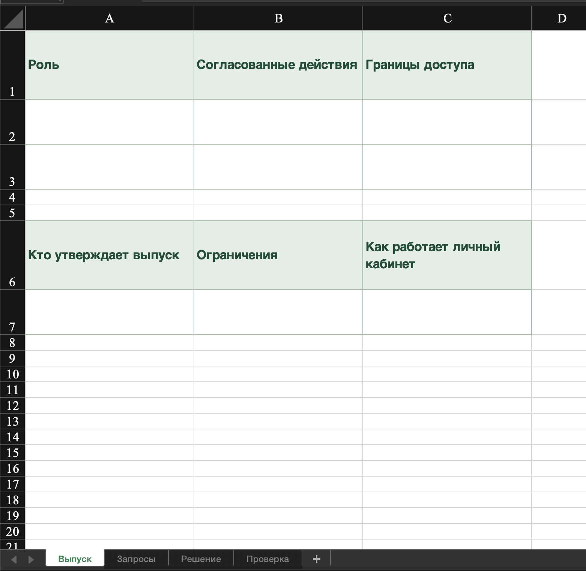
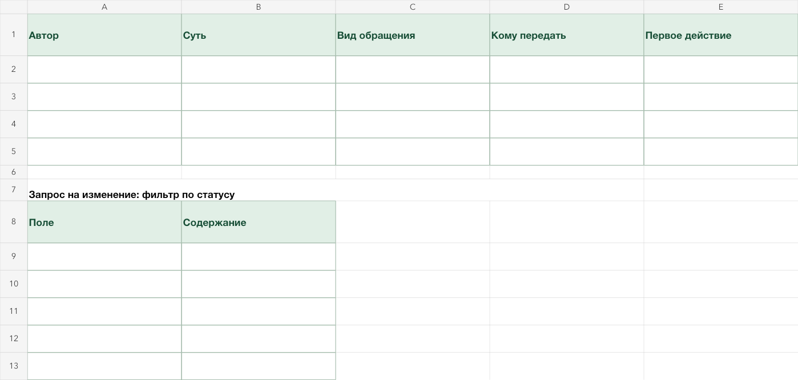
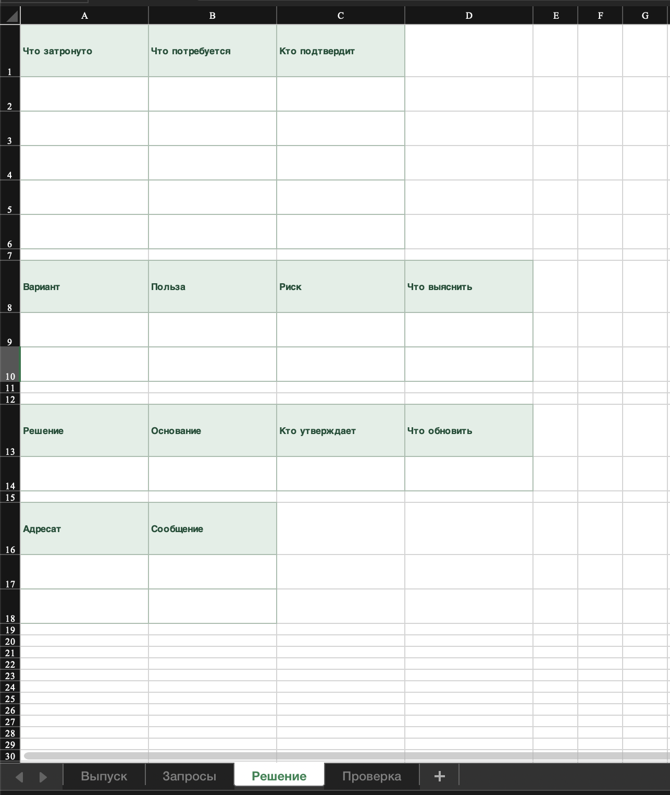
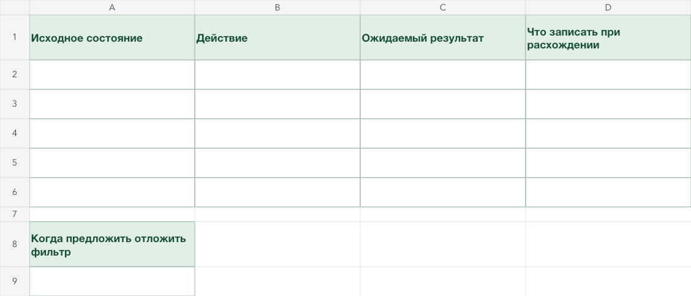

# Управление изменениями

## Лекция

### Управление изменениями в проекте

Управление изменениями упорядочивает внесение изменений в проект. Изменение оформляется запросом, который анализируют по влиянию на сроки, бюджет и содержание, затем утверждают или отклоняют. Контроль изменений предотвращает неконтролируемое расширение содержания проекта.

**Пример.** Кафе заказало сайт с меню. Через неделю владелец попросил добавить заказ навынос. Команда выясняет, какие работы понадобятся, и передаёт запрос на согласование.

```text
Меню на сайте → Просьба о заказе навынос → Оценка работ → Решение
```

### Исходные договорённости

Сначала проверьте, что уже согласовано: какие функции должны работать, кто ими пользуется и как их проверят. Это записано в требованиях или в плане проекта. Затем определите, с чем к вам обратились.

- **Изменение** — просят добавить новую функцию или переделать согласованную. Перед решением оцените, как это повлияет на объём работ, сроки и бюджет.
- **Возможный дефект** — уже согласованная функция работает не так, как описано в требованиях. Сначала проверьте, повторяется ли проблема.
- **Уточнение** — нужно прояснить договорённость, например кто может пользоваться функцией.

**Пример.** Автосервис согласовал запись на ремонт через сайт. Напоминание о визите — новая функция. Если уже подтверждённая запись исчезла, это возможный дефект. Вопрос о том, кто видит запись, требует уточнения.

```text
Согласовали: запись на ремонт
  ├─ Добавить напоминание → изменение
  ├─ Подтверждённая запись исчезла → возможный дефект
  └─ Кто видит запись? → уточнение
```

### Запрос на изменение

В запросе указывают автора, причину, предлагаемую доработку и ожидаемый результат. Формулировка «сделать список удобнее» описывает проблему слишком широко. Формулировку «диспетчер выбирает статус и видит только заявки с этим статусом; после сброса видит исходный список» можно проверить. В запросе также указывают, для кого действует изменение и какие действия пользователей должны работать по прежним правилам.

**Пример.** Владелец интернет-магазина просит добавить фильтр по размеру обуви. В запросе фиксируют: если покупатель выбирает 38-й размер, сайт показывает только модели, доступные в этом размере.

```text
Покупатель ищет обувь → Выбирает размер 38 → Видит доступные модели
```

### Анализ последствий

Одна просьба может затронуть экран программы, права доступа, старые записи и инструкцию пользователя. Команда выясняет, какие работы нужно добавить, чем придётся пожертвовать при неизменной дате выпуска и нужны ли дополнительные расходы. Сведения, которых пока нет, записывают как вопросы к исполнителям. В решении указывают, какие условия уже подтверждены и какие ещё предстоит проверить.

**Пример.** Служба доставки хочет отправлять сообщение о прибытии курьера. Команде нужно настроить отправку, проверить доставку сообщений и уточнить стоимость услуги перед запуском.

```text
Сообщение о прибытии курьера
  ├─ Настроить отправку
  ├─ Проверить получение сообщения
  └─ Уточнить стоимость услуги
```

### Решение и обновление документов

Ответственный участник утверждает изменение, переносит его в следующий выпуск или отклоняет. В журнале решений фиксируют основание и дальнейшее действие. При согласовании уточняют требования, задачи и порядок приёмки. При переносе сохраняют запрос для следующего выпуска. При отклонении записывают причину и сообщают её автору.

**Пример.** Кинотеатр просит добавить подарочные билеты. Выпуск уже готовят к запуску, поэтому руководитель переносит работу и записывает её в план следующего выпуска.

```text
Подарочные билеты → Перенос → Задача в плане следующего выпуска
```

### Разбор примера

Гостиница просит показать номер комнаты в подтверждении бронирования. Если администратор уже назначает комнату в системе, достаточно вывести номер в письме. Если комнату назначают только при заселении, придётся менять порядок работы. Руководитель согласует вывод номера для тех бронирований, где комната уже назначена.

```text
Комната уже назначена?
  ├─ Да → показать номер в письме
  └─ Нет → решить, когда и кто назначает комнату
```


**Запишите в тетрадь** определение, состав запроса, порядок анализа и возможные решения. Зарисуйте схему. Под третьим блоком подпишите три исхода: включить в выпуск, перенести, отклонить. Рядом с каждым запишите, какое действие следует дальше.

## Практическая работа. Пиццерия запускает онлайн-заказы


В пятницу вечером пиццерия впервые будет принимать заказы через сайт. До запуска осталась одна смена. Вы помогаете управляющему решить, какие изменения войдут в первую версию.

### Как работает сайт

Покупатель выбирает пиццу и оформляет заказ навынос. Он указывает **имя для выдачи** и видит только свои заказы. Кассир видит все заказы и меняет их статус: **«Новый» → «Готовится» → «Выдан»**. Имя покупателя должно сохраняться и отображаться в заказе. В пятницу сайт должен заработать, деньги на дополнительные услуги не выделены. Состав выпуска утверждает управляющий.

### Сообщения перед запуском


1. **Кассир:** «Добавьте фильтр по статусу. Когда заказов много, трудно найти те, которые ещё готовятся».
2. **Покупатель:** «Указал имя для выдачи, но после оформления оно исчезло».
3. **Маркетолог:** «Хочу выгружать заказы вместе с телефонами покупателей для рекламной рассылки». Использование контактов для рассылки ещё предстоит согласовать.
4. **Управляющий:** «На старте фильтр нужен только кассиру. Добавляйте его, только если успеете проверить до пятницы».

**Оформление.** Откройте **Excel → Создать → Пустая книга**. Создайте четыре листа: **«Выпуск», «Запросы», «Решение», «Проверка»**. Перенесите заголовки со скриншотов и поставьте границы. Если Excel недоступен, начертите в тетради четыре подписанные таблицы с теми же блоками. Все ответы относятся к пиццерии. Для работы достаточно условия и таблиц.

### Этап 1. Запишите, что покупатель и кассир могут делать на сайте



Возьмите ответы из абзаца **«Как работает сайт»**. В Excel заполняйте ячейки по адресам ниже. В тетради используйте те же строки под соответствующими заголовками.

1. **Строка 2 — покупатель.** В **A2** напишите «Покупатель», в **B2** — «Выбирает пиццу и оформляет заказ навынос». В **C2** запишите, чьи заказы покупатель видит. Найдите это в условии.
2. **Строка 3 — кассир.** В **A3** напишите «Кассир». В **B3** запишите, что он делает со статусом заказа. В **C3** — чьи заказы видит.
3. **Строка 7 — решение перед запуском.** В **A7** запишите, кто решает, что войдёт в первую версию сайта. В **B7** — когда сайт должен заработать и есть ли деньги на дополнительные услуги. В **C7** — какие заказы покупатель будет видеть в своём кабинете и появится ли там фильтр. Для этой ячейки прочитайте сообщение управляющего.

Строки 1 и 6 — заголовки. Строки 4 и 5 оставьте пустыми, чтобы разделить две таблицы.

**Пример из проката велосипедов.** «Забронировать велосипед» — действие клиента. «Видит только свои брони» — граница доступа. Проверьте, что ваши строки отвечают на оба вопроса.

### Этап 2. Разберите сообщения



- **Строки 2–5.** Возьмите четыре сообщения из раздела «Сообщения перед запуском». В каждую строку впишите одного автора и кратко передайте суть его сообщения. Определите вид каждого: предложение об изменении, сообщение о возможном дефекте или уточнение. Укажите, кому его передать и с чего начать. Для пропавшего имени запишите, какое согласованное поведение нужно проверить.
- **Строки 9–13.** В столбце **A** подпишите пять полей: «Автор», «Причина», «Что добавить», «Для кого действует», «Как проверить». Напротив каждого, в столбце **B**, запишите ответ по кейсу. В последней строке запишите, что кассир должен увидеть при выборе статуса и после сброса.

**Пример из кинотеатра.** Кассир просит добавить подарочный билет, которого пока нет в продаже. Это предложение об изменении. Первым делом уточняют, где билет будут продавать. Подумайте, как бы вы назвали обращение, если подарочный билет уже был согласован, но исчез с сайта.

### Этап 3. Примите решение перед запуском



1. **Строки 2–6 — что изменится при добавлении фильтра.** По одной строке на каждый пункт: экран кассира, данные заказа, доступ покупателя, инструкция кассира и проверка перед запуском. В каждой укажите работу и того, кто подтвердит результат.
2. **Строки 9–10 — варианты.** В первой строке рассмотрите запуск с фильтром, во второй — запуск без фильтра. Сравните два варианта: выпустить фильтр только для кассира или отложить. Для каждого запишите пользу, риск и вопрос, который надо выяснить до решения.
3. **Строка 14 — ваше решение.** Выберите вариант и обоснуйте его. Укажите, кто утвердит решение и какой документ обновите после утверждения, например план выпуска.
4. **Новая вводная.** Фильтр сделали, но после обновления ещё никто не проверял, сохраняется ли имя для выдачи. В свободной строке 15 допишите, меняет ли это ваш выбор и какое наблюдение поможет принять окончательное решение.
5. **Строки 17–18 — сообщения.** Напишите покупателю, что проверит команда, и маркетологу, какой вопрос о контактах нужно решить до выгрузки.

**Пример из мастерской.** Сервис хочет отправлять клиентам уведомления о готовности ремонта. Если рассылку ещё не проверили, мастерская может запуститься с прежними уведомлениями. Чтобы обосновать решение, запишите конкретное условие: кому должно прийти сообщение и в какой момент.

### Этап 4. Подготовьте проверки



На экране кассира три заказа: **П-01 «Новый»**, **П-02 «Готовится»**, **П-03 «Готовится»**. П-01 и П-03 принадлежат Саше, П-02 — Жене. Заказов со статусом «Выдан» пока нет.

Заполните строки 2–6 по пяти ситуациям ниже. В столбце **A** запишите, что есть до проверки, в **B** — что делает человек, в **C** — что должно появиться на экране, в **D** — какую подробность вы запишете, если увидите другой результат.

1. Кассир выбирает «Готовится».
2. Кассир выбирает «Выдан».
3. Кассир сбрасывает фильтр после выбора «Готовится».
4. Саша открывает личный кабинет.
5. Женя оформляет новый заказ, указывает имя для выдачи и открывает заказ снова.

В **A9**, под заголовком «Когда предложить отложить фильтр», запишите, при каком результате вы отложите выпуск фильтра. Отметьте, какая проверка относится к отдельной жалобе об имени.

**Пример из магазина обуви.** Если в каталоге есть кеды 38-го размера и ботинки 40-го, после выбора 38-го должны остаться кеды. Если ботинки всё ещё видны, запишите выбранный размер и лишний товар. В своей таблице так же указывайте номера заказов там, где они известны.

### Самопроверка и показ

Проверьте, что вы различили просьбу о новом фильтре и жалобу на пропавшее имя. Сверьте решение с условиями запуска. В проверках должно быть ясно, что сделать и какие заказы ожидать.

**Покажите на месте** схему из конспекта, запрос на фильтр, своё решение и две проверки: сброс фильтра и личный кабинет покупателя.

## Самостоятельное задание. Три просьбы перед открытием

Придумайте свой проект. Это может быть прокат самокатов, сайт музыкального фестиваля, сервис записи в барбершоп или другая знакомая ситуация. Вы готовите первую версию к открытию, а команда до открытия успеет решить только один вопрос.

1. **Опишите проект.** Запишите, кто будет им пользоваться, какие две возможности уже согласованы и что ограничивает команду перед открытием.
2. **Напишите три сообщения от участников.** Один просит новую возможность, другой сообщает, что уже согласованная возможность работает неправильно, третий уточняет, кому доступна одна из функций. Напишите каждое сообщение словами персонажа.
3. **Подготовьте ответ команды.** Под каждым сообщением укажите, кто возьмёт его в работу и что сделает первым. Выберите одно обращение, которым команда займётся до открытия. Объясните, что произойдёт с остальными и почему ваш выбор важен для пользователей.
4. **Добавьте поворот.** Придумайте новый факт, который мог бы изменить ваше решение. Запишите, что именно вы изменили бы и почему.

**Что показать.** Один отдельный лист Excel или одну страницу тетради с описанием проекта, тремя сообщениями и решением до и после нового факта.
