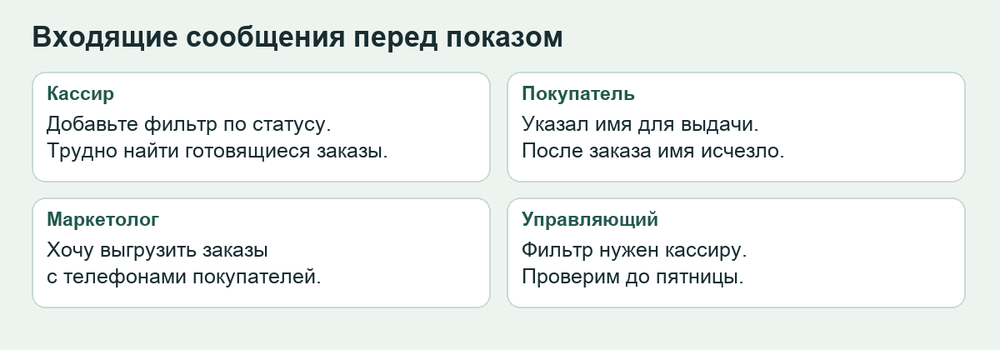

# Управление изменениями

На занятии — 25 минут на конспект и схему, 55 минут на практическую, 10 минут на самопроверку и показ результата.

## Лекция

### Управление изменениями в проекте

Управление изменениями упорядочивает внесение изменений в проект. Изменение оформляется запросом, который анализируют по влиянию на сроки, бюджет и содержание, затем утверждают или отклоняют. Контроль изменений предотвращает неконтролируемое расширение содержания проекта.

**Пример.** Кафе заказало сайт с меню. Через неделю владелец попросил добавить заказ навынос. Команда выясняет, какие работы понадобятся, и передаёт запрос на согласование.

```text
Меню на сайте → Просьба о заказе навынос → Оценка работ → Решение
```

### Исходные договорённости

Прежде чем оценивать новую просьбу, восстанавливают исходное соглашение: какие функции входят в выпуск, кому они предназначены и как результат примут. Эти сведения берут из требований, плана и ранее согласованных решений. Просьба добавить новую функцию меняет согласованный объём работ. Сообщение о том, что программа не выполняет уже согласованное требование, требует проверки на дефект. Уточнение помогает однозначно понять уже согласованную работу или определить границы предложенного изменения.

**Пример.** Автосервис согласовал запись на ремонт через сайт. Напоминание о визите — новая функция. Если уже подтверждённая запись исчезла, это возможный дефект. Вопрос о том, кто видит запись, требует уточнения.

```text
Согласовали: запись на ремонт
  ├─ Добавить напоминание → изменение
  ├─ Подтверждённая запись исчезла → возможный дефект
  └─ Кто видит запись? → уточнение
```

### Запрос на изменение

В запросе указывают автора, причину, предлагаемую доработку и ожидаемый результат. Формулировка «сделать список удобнее» описывает проблему слишком широко. Формулировку «диспетчер выбирает статус и видит только заявки с этим статусом; после сброса видит исходный список» можно проверить. В запросе также указывают, для кого действует изменение и какие действия пользователей должны работать по прежним правилам.

**Пример.** Владелец интернет-магазина просит добавить фильтр по размеру обуви. В запросе фиксируют: если покупатель выбирает 38-й размер, сайт показывает только модели, доступные в этом размере.

```text
Покупатель ищет обувь → Выбирает размер 38 → Видит доступные модели
```

### Анализ последствий

Одна просьба может затронуть экран программы, права доступа, старые записи и инструкцию пользователя. Команда выясняет, какие работы нужно добавить, чем придётся пожертвовать при неизменной дате выпуска и нужны ли дополнительные расходы. Сведения, которых пока нет, записывают как вопросы к исполнителям. В решении указывают, какие условия уже подтверждены и какие ещё предстоит проверить.

**Пример.** Служба доставки хочет отправлять сообщение о прибытии курьера. Команде нужно настроить отправку, проверить доставку сообщений и уточнить стоимость услуги перед запуском.

```text
Сообщение о прибытии курьера
  ├─ Настроить отправку
  ├─ Проверить получение сообщения
  └─ Уточнить стоимость услуги
```

### Решение и обновление документов

Ответственный участник утверждает изменение, переносит его в следующий выпуск или отклоняет. В журнале решений фиксируют основание и дальнейшее действие. При согласовании уточняют требования, задачи и порядок приёмки. При переносе сохраняют запрос для следующего выпуска. При отклонении записывают причину и сообщают её автору.

**Пример.** Кинотеатр просит добавить подарочные билеты. Выпуск уже готовят к запуску, поэтому руководитель переносит работу и записывает её в план следующего выпуска.

```text
Подарочные билеты → Перенос → Задача в плане следующего выпуска
```

### Разбор примера

Гостиница просит показать номер комнаты в подтверждении бронирования. Если администратор уже назначает комнату в системе, достаточно вывести номер в письме. Если комнату назначают только при заселении, придётся менять порядок работы. Руководитель согласует вывод номера для тех бронирований, где комната уже назначена.

```text
Комната уже назначена?
  ├─ Да → показать номер в письме
  └─ Нет → решить, когда и кто назначает комнату
```


**Запишите в тетрадь** определение, состав запроса, порядок анализа и возможные решения. Зарисуйте схему. Под третьим блоком подпишите три исхода: включить в выпуск, перенести, отклонить. Рядом с каждым запишите, какое действие следует дальше.

## Практическая работа. Подготовка выпуска системы заявок


**Ваша роль — координатор выпуска.** Подготовьте решение для руководителя проекта. К показу могут войти разные работы, поэтому сначала разберите, о чём на самом деле просит каждый участник.



### Подготовка

Откройте **Excel → Создать → Пустая книга**. Создайте листы «Выпуск», «Запросы», «Решение» и «Проверка». Сохраните книгу как «Изменения_Фамилия.xlsx». Если Excel недоступен, оформите четыре раздела в тетради. Все исходные данные приведены ниже.

### Исходные данные

Сотрудник создаёт заявку на ремонт и видит только свои заявки. В форме предусмотрено поле «Кабинет», значение которого должно оставаться в карточке после сохранения. Диспетчер видит все заявки и меняет статус: «Новая», «В работе», «Закрыта». Статусы уже хранятся в системе. В понедельник систему показывают заказчику. Дату менять нельзя. Дополнительные расходы не согласованы. Состав выпуска утверждает руководитель проекта.

1. Диспетчер просит фильтр по статусу, чтобы на показе быстро найти незавершённые заявки.
2. Сотрудник сообщает, что у новой заявки пропало название кабинета после сохранения.
3. Заведующая хозяйством просит выгрузку всех заявок с данными сотрудников для рассылки по почте. Состав данных и доступ к ним ещё не согласованы.
4. Руководитель проекта уточняет, что фильтр нужен только диспетчеру. Он готов рассмотреть включение в выпуск при условии, что команда успеет проверить изменение до показа.

### Этап 1. Восстановите состав выпуска · 8 минут

На листе «Выпуск» сделайте столбцы «Роль», «Согласованные действия», «Границы доступа». Заполните строки для сотрудника и диспетчера. Под таблицей запишите, кто утверждает выпуск и какие два ограничения заданы до начала работы. Отдельно сформулируйте, какое поведение личного кабинета должно сохраниться при добавлении фильтра.

### Этап 2. Разберите обращения · 12 минут

На листе «Запросы» сделайте столбцы «Автор», «Суть», «Вид обращения», «Кому передать», «Первое действие». Разберите все четыре сообщения. Используйте виды «изменение», «сообщение о дефекте», «уточнение». Для сообщения о кабинете запишите, какое согласованное поведение надо проверить. Свяжите уточнение руководителя с нужным обращением.

На том же листе **«Запросы»**, под таблицей обращений, напишите заголовок **«Запрос на изменение: фильтр по статусу»**. Под ним сделайте два столбца — «Поле» и «Содержание». Заполните пять строк по этому образцу:

- **Автор** — диспетчер.
- **Причина** — перед показом нужно быстро находить незавершённые заявки.
- **Что добавить** — выбор статуса в списке заявок диспетчера.
- **Где действует изменение** — только в списке диспетчера. Личный кабинет сотрудника работает по прежним правилам.
- **Как проверить** — допишите два ожидаемых результата: какие заявки видны при выборе «В работе» и какие видны после сброса фильтра.

### Этап 3. Подготовьте решение · 20 минут

1. На листе «Решение» создайте столбцы «Что затронуто», «Что потребуется», «Кто подтвердит». Разберите интерфейс диспетчера, данные, доступ сотрудников, инструкцию и проверку выпуска.
2. Сравните два варианта: включить фильтр только для диспетчера или перенести на следующий выпуск. Для каждого укажите пользу, риск и сведения, которые нужны для решения. Отметьте, что известно точно, а что надо уточнить.
3. Напишите запись для журнала решений: предлагаемое решение, основание, кто утверждает, какой документ обновить после утверждения. Если предлагаете включение, укажите условие, при котором команда успеет подтвердить готовность.
4. Представьте, что перед самым показом команда прислала новую информацию: фильтр готов, но проверка кабинета сотрудника после обновления ещё не проведена. Запишите, что вы измените в решении и какое подтверждение позволит пересмотреть его.
5. Напишите два коротких сообщения. Сотруднику объясните, как будет проверено исчезновение кабинета. Заведующей задайте вопрос о составе разрешённых данных и согласовании доступа к выгрузке.

### Этап 4. Подготовьте условия проверки · 15 минут

На листе «Проверка» создайте столбцы «Исходное состояние», «Действие», «Ожидаемый результат», «Что записать при расхождении». Заполните пять строк:

- диспетчер выбирает статус, по которому есть заявки
- диспетчер выбирает статус, по которому заявок нет
- диспетчер сбрасывает фильтр
- сотрудник открывает список, когда в системе есть его и чужие заявки
- сотрудник сохраняет заявку с кабинетом и открывает её повторно

Укажите, какие строки нужны для приёмки фильтра, а какая относится к обращению о кабинете. Под таблицей напишите, при каком наблюдении вы предложите отложить фильтр.

### Самопроверка и показ · 10 минут

Проверьте, что фильтр и выгрузка оформлены отдельно, сообщение о кабинете связано с согласованным требованием, а вывод по выпуску учитывает ограничения. У каждой проверки должны быть действие и наблюдаемый результат.

**Покажите преподавателю на экране или в тетради:** схему в тетради, заполненный запрос на добавление фильтра на листе «Запросы», запись о решении на листе «Решение» и две строки на листе «Проверка» — сброс фильтра и доступ сотрудника.

**Если закончили раньше.** Диспетчер просит сохранять выбранный фильтр после выхода. Допишите, какие данные понадобится хранить, чем отличается проверка повторного входа под тем же и другим пользователем и как меняется решение о выпуске.
