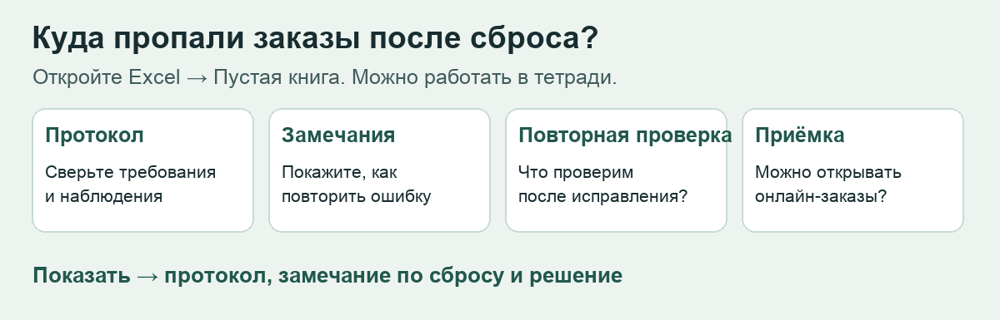
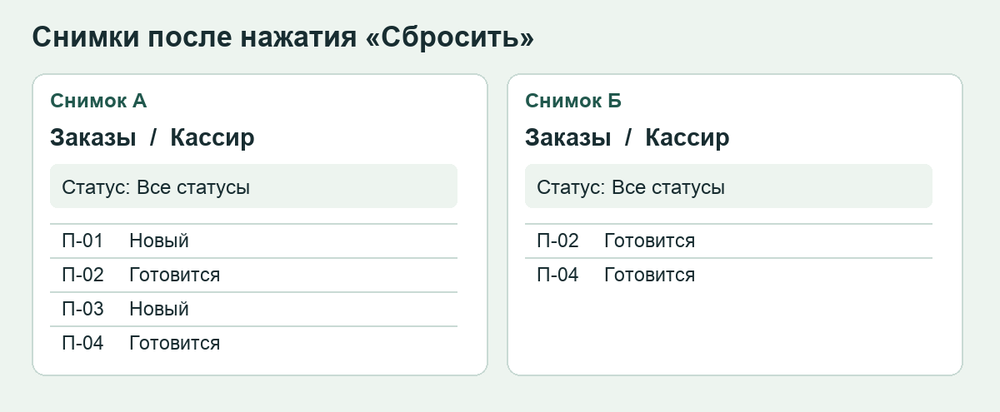
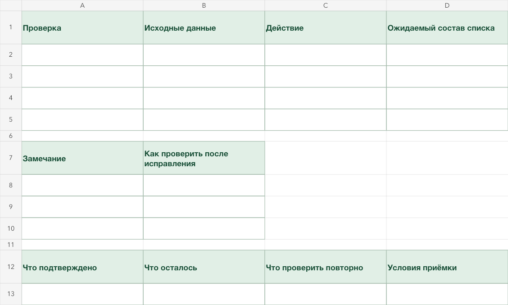

# Управление качеством

На занятии — 25 минут на конспект и схему, 55 минут на практическую, 10 минут на самопроверку и показ результата.

## Лекция

### Управление качеством в проекте

Управление качеством обеспечивает соответствие продукта требованиям. Включает планирование качества (критерии и стандарты), обеспечение качества (процессы) и контроль качества (проверки, тестирование). В разработке ПО применяют код-ревью, тестирование, стандарты оформления кода.

**Пример.** В интернет-магазине промокод должен менять итоговую стоимость заказа. Команда заранее описывает правило, просматривает изменения и проверяет, что пересчитанная цена видна в корзине.

```text
Описать правило скидки → Просмотреть изменение → Проверить итог в корзине
```

### Планирование качества

До начала проверки определяют, каким требованиям должен соответствовать результат. Формулировку «заявку удобно отправлять» трудно проверить. Её уточняют: заполненная заявка сохраняется, а при попытке отправить форму без обязательного поля пользователь видит сообщение и остаётся на форме. По согласованному поведению проверяющий сможет подготовить исходные данные и определить ожидаемый результат.

**Пример.** Прачечная принимает заявки на вывоз белья. Адрес обязателен. До проверки записывают ожидаемый результат: без адреса заявка не сохраняется, рядом с полем появляется подсказка.

```text
Адрес пуст → Нажать «Отправить» → Форма открыта, видна подсказка
```

### Обеспечение качества

Команда договаривается, кто проверяет требования и изменения, где хранится действующая инструкция и как передаётся работа на приёмку. Например, при просмотре изменения экрана коллега замечает, что разработчик учёл диспетчера и не проверил личный кабинет сотрудника. До выпуска команда добавляет проверку для второй роли и уточняет инструкцию.

**Пример.** Пункт проката проверяет бронирование велосипеда. Коллега замечает, что команда подготовила проверку только для свободного велосипеда. В план добавляют случай, когда велосипед уже забронирован.

```text
Просмотр плана → Найден пропуск → Добавлена проверка занятого велосипеда
```

### Контроль качества

Проверяющий выполняет действие и сопоставляет наблюдение с ожидаемым результатом. В протоколе сохраняет исходное состояние, действие, ожидание и наблюдение. Когда поведение отличается от требования, оформляют замечание. Если проверка остановилась на входе или не хватает данных, фиксируют причину и условия для повторной попытки.

**Пример.** В приложении доставки проверяющий меняет номер квартиры на 42 и повторно открывает адрес. На экране по-прежнему указан прежний номер 14. Проверяющий фиксирует расхождение.

```text
Ввести 42 → Сохранить → Открыть адрес снова
                       ├─ Ожидалось: 42
                       └─ Получено: 14
```

### Замечание и повторная проверка

Замечание должно позволять другому человеку повторить ситуацию. Для этого указывают роль, исходные данные, шаги, ожидаемое и фактическое поведение. После исправления выполняют исходную проверку повторно. Затем проверяют соседние действия, которые могло затронуть исправление. Например, после исправления сброса фильтра проверяют повторный выбор статуса, смену статуса и доступ сотрудника к его заявкам.

**Пример.** После исправления сброса фильтра в каталоге автозапчастей снова проверяют сброс. Затем выбирают марку машины повторно и убеждаются, что каталог показывает запчасти для этой марки.

```text
Исправлен сброс → Проверить полный каталог → Снова выбрать марку
```


**Запишите в тетрадь** определения трёх видов работы с качеством и по одному примеру каждого. Зарисуйте схему. Под блоком сравнения подпишите два исхода: проверка пройдена или требуется замечание.

## Практическая работа. Последняя проверка перед открытием пиццерии



До запуска онлайн-заказов осталась одна смена. Фильтр по статусу уже добавили. Кассир нажал «Сбросить», но часть заказов так и не появилась. Вы разбираете результаты пробного запуска и готовите заключение для управляющего.



**Оформление.** Откройте **Excel → Создать → Пустая книга**. Создайте листы **«Проверки», «Замечания», «Приёмка»**. Перенесите заголовки со скриншотов и поставьте границы. Если Excel нет, оформите эти три раздела в тетради. Программа условная, все наблюдения приведены ниже.

### Как должен работать сайт

1. Кассир видит все заказы. После выбора статуса видны только заказы с этим статусом.
2. Если заказов с выбранным статусом нет, появляется сообщение «Заказов нет».
3. После сброса фильтра кассир снова видит все заказы.
4. Покупатель видит только свои заказы. Фильтра в его личном кабинете нет.
5. После оформления заказа имя для выдачи сохраняется и видно в карточке.
6. Если кассир меняет статус заказа, заказ появляется в списке по новому статусу.

### Протокол пробного запуска

В начале каждого опыта есть четыре заказа: **П-01** (Саша, «Новый»), **П-02** (Женя, «Готовится»), **П-03** (Саша, «Новый»), **П-04** (Женя, «Готовится»). Выданных заказов нет.

- **А.** Кассир открывает список без фильтра. Видны П-01, П-02, П-03, П-04.
- **Б.** Кассир выбирает «Готовится». Видны П-02 и П-04.
- **В.** Кассир выбирает «Выдан». Список пуст, сообщения нет.
- **Г.** Кассир выбирает «Готовится» и нажимает «Сбросить». Поле показывает «Все статусы», но в списке остаются П-02 и П-04.
- **Д.** Саша открывает личный кабинет. Видны П-01 и П-03. Фильтра нет.
- **Е.** Женя оформляет новый заказ с именем для выдачи «Женя» и открывает его снова. Поле имени пустое.
- **Ж.** Кассир переводит П-01 в «Готовится» и открывает список по этому статусу. Видны П-01, П-02 и П-04.
- **З.** Проверяющий пытается войти как Женя для отдельной проверки личного кабинета. Вход недоступен, список не открывался.

### Этап 1. Разберите протокол · 15 минут


Заполните восемь строк. Для каждого опыта укажите требование, роль, действие, ожидаемое и фактическое поведение. В выводе выберите «пройдена», «расхождение» или «не выполнена». В нижнем блоке объясните, какой снимок соответствует опыту Г и почему по опыту З нельзя судить о списке Жени.

**Пример из прачечной.** Форма без адреса должна показать подсказку. Если подсказка появилась, проверка пройдена. Если форма вообще не открылась, проверить подсказку не удалось.

### Этап 2. Запишите замечания · 15 минут


По каждому наблюдаемому расхождению заполните одну строку. Укажите заголовок, требование, роль, исходные данные, шаги, ожидаемое и фактическое поведение. В последнем столбце объясните, чем проблема мешает покупателю или кассиру. В нижнем блоке запишите, какой доступ нужен для повторения опыта З.

**Пример из кинотеатра.** В подтверждении указан сеанс на 20:00, хотя зритель выбрал 18:00. Для повторения укажите выбранный фильм, время и место, где появилось другое время.

### Этап 3. Спланируйте повторную проверку · 15 минут



Разработчик сообщил: «Исправили сброс. Список заново загружается при нажатии кнопки. Имя для выдачи пока не исправили».

В верхнем блоке запишите четыре проверки: сброс, повторный выбор статуса, смена статуса заказа и просмотр своих заказов покупателем. Укажите конкретные заказы, которые должны появиться. В среднем блоке перечислите открытые замечания и запишите, как их проверить после исправления.

**Пример из проката.** После исправления отмены брони сначала проверяют, что велосипед снова свободен, а затем пробуют его забронировать на то же время.

### Этап 4. Решите, можно ли открываться · 10 минут

В нижнем блоке «Приёмки» запишите для управляющего: что уже подтверждено, какие проблемы остались, что нужно проверить ещё раз и при каком результате вы предложите открыть онлайн-заказы. Учитывайте, сможет ли кассир выдать заказ, если имя не сохранилось.

### Самопроверка и показ · 10 минут

Сверьте свои выводы с требованиями и наблюдениями. В замечании по сбросу укажите, какие заказы пропали, хотя должны были вернуться.

**Покажите на месте** схему из конспекта, протокол, замечание по сбросу и заключение о запуске.

**Если закончили раньше.** Кассир выбирает «Готовится», затем «Новый» и только после этого нажимает «Сбросить». Укажите ожидаемый состав списка после каждого шага.
