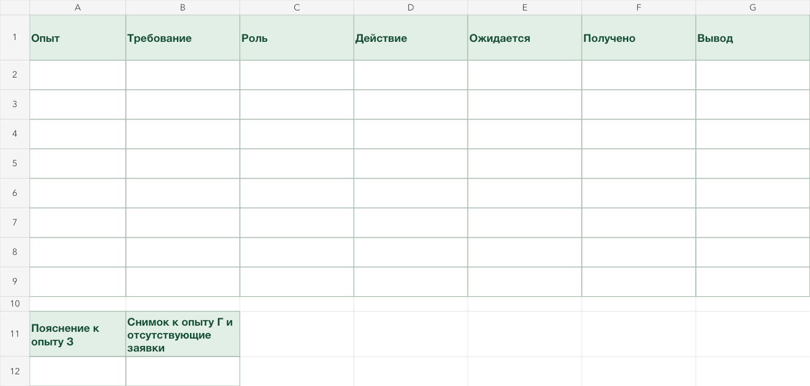
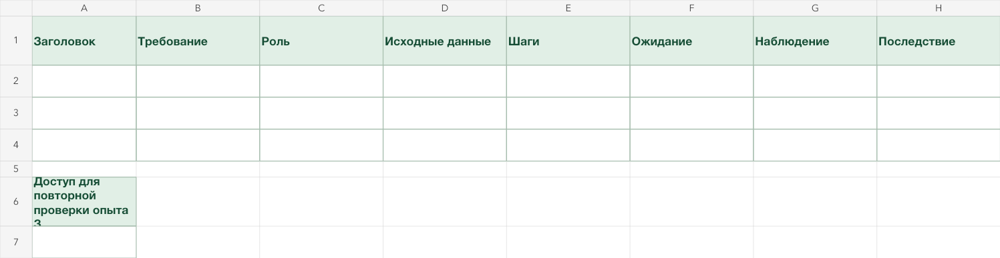

# Управление качеством

На занятии — 25 минут на конспект и схему, 55 минут на практическую, 10 минут на самопроверку и показ результата.

## Лекция

### Управление качеством в проекте

Управление качеством обеспечивает соответствие продукта требованиям. Включает планирование качества (критерии и стандарты), обеспечение качества (процессы) и контроль качества (проверки, тестирование). В разработке ПО применяют код-ревью, тестирование, стандарты оформления кода.

**Пример.** В интернет-магазине промокод должен менять итоговую стоимость заказа. Команда заранее описывает правило, просматривает изменения и проверяет, что пересчитанная цена видна в корзине.

```text
Описать правило скидки → Просмотреть изменение → Проверить итог в корзине
```

### Планирование качества

До начала проверки определяют, каким требованиям должен соответствовать результат. Формулировку «заявку удобно отправлять» трудно проверить. Её уточняют: заполненная заявка сохраняется, а при попытке отправить форму без обязательного поля пользователь видит сообщение и остаётся на форме. По согласованному поведению проверяющий сможет подготовить исходные данные и определить ожидаемый результат.

**Пример.** Прачечная принимает заявки на вывоз белья. Адрес обязателен. До проверки записывают ожидаемый результат: без адреса заявка не сохраняется, рядом с полем появляется подсказка.

```text
Адрес пуст → Нажать «Отправить» → Форма открыта, видна подсказка
```

### Обеспечение качества

Команда договаривается, кто проверяет требования и изменения, где хранится действующая инструкция и как передаётся работа на приёмку. Например, при просмотре изменения экрана коллега замечает, что разработчик учёл диспетчера и не проверил личный кабинет сотрудника. До выпуска команда добавляет проверку для второй роли и уточняет инструкцию.

**Пример.** Пункт проката проверяет бронирование велосипеда. Коллега замечает, что команда подготовила проверку только для свободного велосипеда. В план добавляют случай, когда велосипед уже забронирован.

```text
Просмотр плана → Найден пропуск → Добавлена проверка занятого велосипеда
```

### Контроль качества

Проверяющий выполняет действие и сопоставляет наблюдение с ожидаемым результатом. В протоколе сохраняет исходное состояние, действие, ожидание и наблюдение. Когда поведение отличается от требования, оформляют замечание. Если проверка остановилась на входе или не хватает данных, фиксируют причину и условия для повторной попытки.

**Пример.** В приложении доставки проверяющий меняет номер квартиры на 42 и повторно открывает адрес. На экране по-прежнему указан прежний номер 14. Проверяющий фиксирует расхождение.

```text
Ввести 42 → Сохранить → Открыть адрес снова
                       ├─ Ожидалось: 42
                       └─ Получено: 14
```

### Замечание и повторная проверка

Замечание должно позволять другому человеку повторить ситуацию. Для этого указывают роль, исходные данные, шаги, ожидаемое и фактическое поведение. После исправления выполняют исходную проверку повторно. Затем проверяют соседние действия, которые могло затронуть исправление. Например, после исправления сброса фильтра проверяют повторный выбор статуса, смену статуса и доступ сотрудника к его заявкам.

**Пример.** После исправления сброса фильтра в каталоге автозапчастей снова проверяют сброс. Затем выбирают марку машины повторно и убеждаются, что каталог показывает запчасти для этой марки.

```text
Исправлен сброс → Проверить полный каталог → Снова выбрать марку
```


**Запишите в тетрадь** определения трёх видов работы с качеством и по одному примеру каждого. Зарисуйте схему. Под блоком сравнения подпишите два исхода: проверка пройдена или требуется замечание.

## Практическая работа. Приёмка учебного обновления

**Excel.** [Скачайте пустой шаблон](Шаблоны/Качество.xlsx), откройте его и сохраните под своей фамилией. Заполняйте готовые таблицы на указанных листах.


**Ваша роль — проверяющий перед выпуском.** Диспетчер сообщил, что после сброса иногда видит только часть заявок. Перед вами два учебных снимка. Определите, какой мог получиться при нормальной работе, а какой подтверждает обращение диспетчера.


Откройте скачанный шаблон или создайте таблицы по образцам ниже. Сохраните книгу как «Качество_Фамилия.xlsx». Если Excel недоступен, оформите те же разделы в тетради. Протокол ниже уже содержит результаты пробного запуска.

### Согласованные требования

1. Диспетчер видит все заявки. По выбранному статусу список содержит только заявки с этим статусом.
2. Если заявок с выбранным статусом нет, список пуст и появляется сообщение «Заявок нет».
3. После сброса фильтра диспетчер снова видит все заявки.
4. Сотрудник видит только свои заявки. Поле фильтра в личном кабинете отсутствует.
5. После сохранения заявки значение поля «Кабинет» видно в её карточке.
6. Если диспетчер меняет статус заявки, она появляется в списке по новому статусу.

### Данные и протокол

В начале каждого опыта в системе четыре заявки: Р-01 (Анна, «Новая»), Р-02 (Игорь, «В работе»), Р-03 (Анна, «Новая»), Р-04 (Игорь, «В работе»). Закрытых заявок нет.

- **А.** Диспетчер открывает список без фильтра. Видны Р-01, Р-02, Р-03, Р-04.
- **Б.** Диспетчер выбирает «В работе». Видны Р-02 и Р-04.
- **В.** Диспетчер выбирает «Закрыта». Список пуст, сообщения нет.
- **Г.** Диспетчер выбирает «В работе» и сбрасывает фильтр. Поле очищается, но в списке остаются Р-02 и Р-04.
- **Д.** Анна открывает личный кабинет. Видны Р-01 и Р-03. Поля фильтра нет.
- **Е.** Игорь создаёт заявку, вводит кабинет «304», сохраняет и открывает карточку. Поле пустое.
- **Ж.** Диспетчер переводит Р-01 в «В работе» и открывает список по этому статусу. Видны Р-01, Р-02 и Р-04.
- **З.** Проверяющий пытается войти под учётной записью Игоря для отдельной проверки личного кабинета. Вход недоступен. Список заявок не открывался.

### Этап 1. Разберите протокол · 15 минут

<details>
<summary>Как выглядит пустой лист «Проверки»</summary>



</details>

На листе «Проверки» создайте столбцы «Опыт», «Требование», «Роль», «Действие», «Ожидается», «Получено», «Вывод». Заполните восемь строк. Где возможно, назовите точные номера заявок. Для вывода используйте «пройдена», «расхождение» или «не выполнена». Объясните, почему по опыту З нельзя сделать вывод о составе списка Игоря. Укажите, какой снимок подтверждает наблюдение из опыта Г и какие строки на нём отсутствуют.

### Этап 2. Оформите замечания · 15 минут

<details>
<summary>Как выглядит пустой лист «Замечания»</summary>



</details>

На листе «Замечания» оформите по карточке на каждое фактическое расхождение. В каждой укажите заголовок, требование, роль, исходные данные, шаги, ожидание, наблюдение и последствие для пользователя. Например, из замечания о пустом поле должно быть понятно, какое значение вводили и в какой момент оно пропало. Отдельно запишите, какой доступ понадобится для выполнения опыта З.

### Этап 3. Подготовьте повторные проверки · 15 минут

<details>
<summary>Как выглядит пустой лист «Приёмка»</summary>


</details>

Разработчик сообщил: «Исправил сброс фильтра. После нажатия кнопки список обновляется. Исправление кабинета ещё в работе».

На листе «Приёмка» запишите четыре проверки: сброс фильтра, повторное применение фильтра, изменение статуса и просмотр своих заявок сотрудником. Для каждой укажите исходные данные, действие и ожидаемый состав списка. Назначьте каждому снимку роль в повторной проверке: какой соответствует ожидаемому виду экрана и какой показывает прежнее поведение. Отдельно перечислите замечания, по которым в сообщении разработчика нет сведений об исправлении. Укажите, как их проверить после исправления.

### Этап 4. Составьте заключение · 10 минут

Напишите руководителю проекта короткое заключение. Укажите, что подтверждено пробным запуском, какие расхождения остались, почему сообщение разработчика ещё требует проверки и при каких условиях можно принять обновление.

### Самопроверка и показ · 10 минут

У каждого вывода в протоколе есть требование и наблюдение. Для сброса сверьте состав списка с исходными данными. Проверьте, что по замечанию другой человек сможет повторить ваши действия.

**Покажите преподавателю на экране или в тетради:** схему, протокол, замечание по сбросу и заключение о приёмке.

**Если закончили раньше.** Добавьте проверку последовательных переходов: «В работе» → «Новая» → сброс. Для каждого действия укажите точный состав списка. Добавьте ещё один опыт, в котором диспетчер переводит Р-04 в «Закрыта», и запишите, как должны выглядеть списки «В работе» и «Закрыта».
